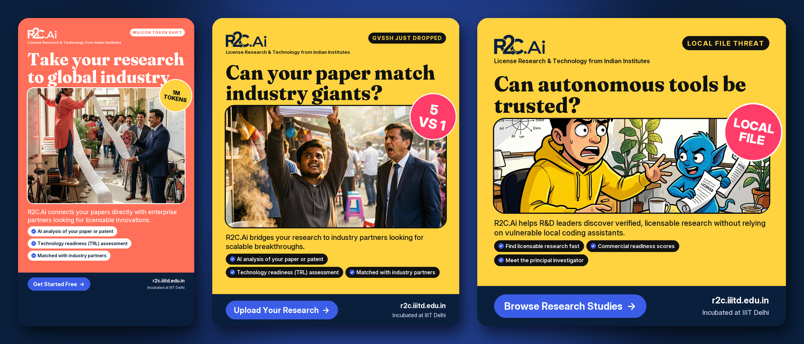
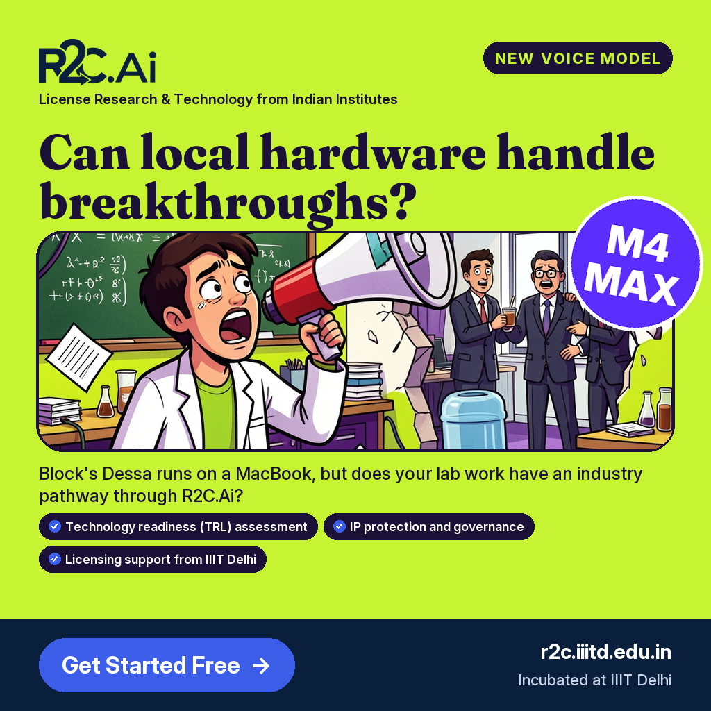
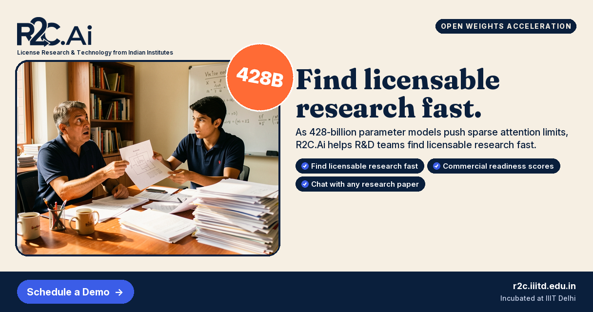

<div align="center">

# Trend → Ad: an autonomous AI ad studio

**Every morning it crawls 48 sources for what's trending in AI, ranks the trends, and turns the best new ones into branded, ready-to-post ads and 25–35 second trend-specific video ads (AI pictures and motion, voiceover, music, animated captions) for Instagram, Facebook and LinkedIn. A reviewer approves each ad on the live site before it is published. It also benchmarks four image models to pick the best.**

Built for [R2C.Ai](https://r2c.iiitd.edu.in) (Research to Commercialization, incubated at IIIT Delhi).


**[▶ Live demo: R2C.Ai Ad Studio](https://r2c-trend-to-ad-pipeline.vercel.app)**



</div>

---

## What it does

Every ad above was made end to end by the pipeline, with no manual design work:

1. **Discovers** what's moving in AI/ML across 48 sources: 42 RSS feeds (arXiv, AI labs, tech news, expert newsletters, developer communities and Indian tech and startup media) plus Google Trends, Hugging Face (trending models and daily papers), Hacker News, Reddit, Bluesky, Mastodon, Stack Exchange, YouTube and GitHub.
2. **Finds real trends**: embeds every item, clusters items into stories, keeps only stories seen on more than one platform, and ranks them by growth and brand fit.
3. **Writes the ad**: an LLM writes copy on the brand's behalf for a specific audience (researchers or industry). Code rejects hype, filler, invented features and clichés, and requires every subline and caption to name the trend's model or company and a concrete fact from the evidence.
4. **Art-directs the picture**: a creative-director LLM pass invents a grounded, witty scene with real people in real Indian settings, plus a "sticker" hook (for example `1M TOKENS` or `5 VS 1`).
5. **Renders and brands it**: FLUX.2 Klein 9B paints two text-free pictures in the ad's colour theme, Gemini vision picks the better one, and a code-driven poster template wraps the branding around it: logo, tagline, big headline, picture card with sticker, service chips, CTA and footer, all spelled correctly.
6. **Makes a trend-specific video ad**: a 25–35 second vertical video about that one trend. An LLM writes 4 scenes (hook, proof, why it matters, call to action) from the trend's crawled facts only, and a code check rejects any script that could fit another trend. Then: 3 FLUX.2 Klein 9B pictures, LTX-Video motion, a neural voiceover with word-timed captions, original music, animated graphics (logo, trend tag, source credit, kinetic headline, R2C.Ai feature chips, end card) and camera moves, assembled with FFmpeg. The ad's photo and poster are made from the video's main picture.
7. **Runs itself every morning**: at 7:00 AM IST the site's Vercel cron starts a GitHub Actions job that crawls, ranks and makes the day's new ads and videos, then publishes them to the live site.
8. **Keeps a human in the loop**: new ads wait under *New ads · pending review*; a reviewer approves or rejects each one with a passcode, and only approved ads join the gallery.
9. **Benchmarks image models**: the same prompts go to four image models, Gemini vision scores every picture, and a PDF report recommends the best one.

## Pipeline

```mermaid
flowchart LR
    S(["Daily 7 AM IST<br/>Vercel cron → GitHub Actions"]) --> A
    A["Crawl<br/>48 sources<br/>(Crawlee, feeds, APIs)"] --> B["Embed<br/>gemini-embedding-001"]
    B --> C["Cluster into stories<br/>average linkage + LLM merge"]
    C --> D{"Gate 1<br/>seen on 2+ platforms?"}
    D -- yes --> E{"Gate 2<br/>score ≥ 50 and<br/>brand fit ≥ 40?"}
    E -- "qualified / near miss" --> F["Ad copy<br/>Gemini + rule checks"]
    F --> G["Creative director<br/>scene, sticker, colour theme"]
    G --> H["Prompt assembled<br/>by code"]
    H --> I["Image model<br/>FLUX.2 Klein 9B"]
    I --> J["Poster template<br/>logo · type · chips · CTA"]
    J --> K["Ad photo + poster<br/>4:5 · 9:16 · 1:1"]
    E -- "same trend" --> V1["Video script<br/>gpt-oss-120b + trend check"]
    V1 --> V2["3 pictures FLUX.2 Klein 9B<br/>+ LTX-Video motion"]
    V2 --> V3["Voice · music · animated graphics<br/>FFmpeg"]
    V2 -. "main picture" .-> J
    V3 --> L
    K --> L{"Reviewer<br/>approves?"}
    L -- yes --> M["Live site<br/>Ready ads"]
```



## Prompt → result

The LLM writes structured fields (subject, action, twist, setting, camera, light, mood). Code orders them the way image models weigh them, then adds the colour theme, a "real ad shoot, not CGI" look and a no-text rule.

<table>
<tr>
<td width="55%" valign="top">

**Trend:** GVS5H harness lets five Qwen3.8-27B models match Fable 5
**Audience:** researchers · **Format:** 4:5 Instagram/Facebook feed · **Theme:** solar

> Scroll-stopping social media ad image. Bold editorial advertising photograph, real people and real objects… A young Indian researcher in a casual hoodie triumphantly hoisting a heavy stack of manuscript papers while an exhausted tech executive in a slick suit watches in absolute shock… Setting: a bustling, vibrant Delhi street-side chai stall… Colour palette: sunflower yellow, black and cobalt blue dominate the whole scene… Looks like a real, high-budget ad shoot, not CGI… No text, letters, words, numbers…

**Copy:** *Can your paper match industry giants?* · sticker `5 VS 1` · Upload Your Research

</td>
<td width="45%"></td>
</tr>
</table>

All 9 prompts and results: [`prompts_and_images.md`](data/output/samples/flux-2-klein-9b-v2/prompts_and_images.md)

## Gallery

One ad per trend, in four placements and six colour themes:

| Feed 4:5 | Stories 9:16 | LinkedIn 1:1 |
|---|---|---|
|  |  |  |

| LinkedIn link ad 1.91:1 | LinkedIn link ad 1.91:1 |
|---|---|
|  |  |

## Image model benchmark

The same 9 ad prompts were rendered by four open image models, one image per trend with no retries or cherry-picking. Gemini vision then scored each picture against its prompt from 1 to 10.

| Rank | Model | Size | Overall | Adherence | Realism | Catchiness | Artifacts (10 = none) |
|---|---|---|---|---|---|---|---|
| 🥇 1 | **FLUX.2 Klein 9B** | 9B | **7.6** | 7.8 | 7.4 | 8.9 | 6.4 |
| 2 | FLUX.2 Klein 4B* | 4B | 6.5 | 7.0 | 7.3 | 7.7 | 4.1 |
| 3 | Stable Diffusion 3.5 Medium | 2.5B | 6.5 | 6.3 | 6.0 | 8.1 | 5.4 |
| 4 | SDXL base 1.0 | ~3.5B | 5.1 | 4.1 | 4.8 | 7.0 | 4.7 |

<sub>*Klein 4B was rendered from the earlier prompt version. Qwen-Image-2512 (20B) was evaluated but not run, because it needs paid GPU time.</sub>

**Result:** FLUX.2 Klein 9B is the production model. It is the best on every criterion and the most consistent, with no ad scoring below 6.5. SDXL ranks last mainly because its text encoder reads only about the first 75 tokens of a prompt.

Full report with side-by-side pages for every trend: [`R2C_image_model_comparison.pdf`](data/output/samples/R2C_image_model_comparison.pdf)

## Web app: R2C.Ai Ad Studio

A Flask web app (`app.py`) puts the whole pipeline in the browser. It is deployed on Vercel: **[https://r2c-trend-to-ad-pipeline.vercel.app](https://r2c-trend-to-ad-pipeline.vercel.app)**

- **Latest trends** from the most recent crawl, with score, platforms and R2C relevance, and a "Make an ad" button
- **New ads · pending review**: the ads and trend videos made by the daily run, each with **Approve** / **Reject** buttons (passcode-protected); approved ads move into Ready ads with a NEW badge
- **Ready ads**: the finished poster ads, one per trend, each with its video; approved ads stay in the gallery permanently
- **How each video is made**: the 6 steps and the models table; opening an ad with a trend video shows its 4-scene script, the crawled fact behind each scene and the trend-check result
- **Studio**: switch format (4:5, 9:16, 1:1, 1.91:1) and colour theme instantly, edit the copy, generate a new picture (FLUX.2 Klein 9B, best of 2 picked by Gemini vision), make a 10-second video ad, download both and copy the caption
- **Scrape now**: paste article links (examples from the latest crawl are pre-filled) and click *Scrape & find trends*. The pipeline scrapes them, runs Gate 1 and Gate 2, and lists the topics in about 20 seconds; *Make an ad* turns one into an R2C ad (Gemini copy + FLUX picture + poster)
- **Model benchmark** scorecard

```bash
python scripts/build_web_data.py   # package the latest trends, ads and benchmark for the site
python app.py                      # http://127.0.0.1:5000
```

## Daily automatic run

Every morning at **7:00 AM IST** the site's Vercel cron calls `/api/cron/daily`, which starts the GitHub Actions job ([`.github/workflows/daily.yml`](.github/workflows/daily.yml)) running [`scripts/daily_run.py`](scripts/daily_run.py). (GitHub's own schedule often starts hours late, so it is kept only as an 11:00 AM backup that does nothing if the day's run is already done.)

1. Crawls all 48 sources and ranks trends (Gate 1 + Gate 2). The dedup memory (`data/output/post_history.json`) is kept in the repository, so stories from earlier days are not picked again.
2. For each new trend, up to 2 a day per Cloudflare account, makes the **trend video** ([`image_generator/trend_video.py`](image_generator/trend_video.py)) and the **ad photo and poster** from the video's main picture (Gemini copy, rotating formats and colour themes).
3. Saves them to `web_data/daily.json` and `static/daily/<id>/`, removes unapproved ads older than 7 days (approved ones stay in the gallery), refreshes the latest trends, writes a run report to `web_data/last_run.json`, and pushes. Vercel redeploys automatically.

**Models used for each video:**

| Job | Model | Provider | Cost |
|---|---|---|---|
| Script (voiceover, on-screen text, picture prompts) | gpt-oss-120b (Gemini as backup) | Cloudflare Workers AI | free daily allowance |
| Scene pictures | FLUX.2 Klein 9B | Cloudflare Workers AI | free daily allowance (about 7 pictures a day) |
| Motion from the pictures | LTX-Video, distilled | Hugging Face free demo | free, a few clips a day; scenes without a clip get a camera move |
| Voiceover | Microsoft Edge neural voice "Andrew" (edge-tts) | Microsoft | free |
| Music and sound effects | none: synthesised in code (numpy) | the runner | free, no copyright issues |
| Graphics | none: an HTML page animated frame by frame (Playwright) | the runner | free |
| Assembly | FFmpeg | the runner | free |

**Why 2 a day:** each video needs 3 Klein 9B pictures (about 1,364 of Cloudflare's 10,000 free daily units each), so 2 videos use about 8,200 plus the scripts. An optional second Cloudflare account (`CLOUDFLARE_ACCOUNT_ID_2` / `CLOUDFLARE_API_TOKEN_2`) is used automatically once the first account's allowance is used up, for 4 videos a day. When every allowance runs out mid-run, the unfinished trends go into `web_data/video_queue.json` and are made first the next day, so no picked trend is lost.

New ads appear on the site under **New ads · pending review**. A reviewer clicks **Approve** to move an ad into Ready ads, or **Reject** to hide it. Decisions are saved to `web_data/reviews.json` in the repository.

One run takes about 60–75 minutes (crawl and ranking ~30 min, ~12 min per ad with its video). It can also be started by hand from the repository's **Actions** tab (**Daily trend-to-ad run → Run workflow**), or locally with `python scripts/daily_run.py`.

**Setup:**

| Where | Name | Value |
|---|---|---|
| GitHub → Settings → Secrets and variables → Actions | `GEMINI_API_KEY`, `CLOUDFLARE_ACCOUNT_ID`, `CLOUDFLARE_API_TOKEN` | same as in `.env` (required) |
| same | `YOUTUBE_API_KEY`, `REDDIT_CLIENT_ID`, `REDDIT_CLIENT_SECRET` | optional extra sources |
| same | `CLOUDFLARE_ACCOUNT_ID_2`, `CLOUDFLARE_API_TOKEN_2` | optional second Cloudflare account: 4 videos a day instead of 2 |
| same | `HF_TOKEN` | optional: a Hugging Face login gets more free LTX-Video motion clips |
| Vercel → Project → Settings → Environment Variables | `R2C_REVIEW_KEY` | a passcode reviewers type to approve ads |
| same | `GITHUB_TOKEN` | a fine-grained GitHub token on this repository only with **Contents: read and write** (saves approvals) and **Actions: read and write** (starts the 7 AM run) |
| same | `CRON_SECRET` | any long random string; Vercel sends it with the 7 AM cron call so nobody else can start runs |

## Engineering decisions worth noting

- **Approvals without a database.** The site runs on Vercel, which keeps no files between requests. A reviewer's decision is checked against a server-side passcode (constant-time compare) and saved as a commit to `web_data/reviews.json` through the GitHub API, so every approval is versioned and the daily job picks it up.
- **Survives model outages.** When Gemini answers "high demand" (HTTP 503), the request falls back to the next Gemini model in a list instead of failing the ad. If the planned ad format fails its checks, the next passing format is used. The daily job stops cleanly when the free image allowance is used up and keeps the ads already made.
- **Trend-specific, checked in code.** A video script passes only if its first three scenes and its end line use the trend's own names or figures (for example *INSEP*, *Qwen 32B*, *0.3% → 39.9%*), it has at least three of them, its CTA is copied from the brand's list, and it avoids unexplained jargon. Otherwise it is rewritten.
- **Graphics as a web page.** Captions, kinetic type, chips and wipes are an HTML/CSS page with a `render(t)` function; headless Chrome draws it frame by frame and every frame is composited over the moving picture, so the motion design is ordinary, testable code.
- **Daily dedup memory.** A story already turned into an ad, even when re-worded by a different source, is skipped on later days (title-overlap check plus the post history committed to the repo).

- **Text is typeset, not generated.** When the image model drew the ad text itself, it was spelled correctly in only about 1 of 25 attempts ("Uppload", "Arrrrive"). The model now paints a text-free picture and code typesets every word, so a misspelled ad can never ship.
- **Feedback-driven art direction.** The first ads looked "too AI" (glossy, surreal) and all blue. The prompts now ask for a real ad-shoot look (natural imperfections, film grain, no plastic sheen), grounded and witty scenes, and a different colour theme per ad that matches the poster.
- **The LLM can't invent product claims.** The "How R2C.Ai helps you" chips must be copied word for word from a whitelist of the brand's real services, and the check runs in code.
- **Validation and repair loops.** Every creative brief is checked in code (word limits, hype words, clichés, a different picture idea per ad), and broken briefs go back to the model with the exact errors.
- **Model-agnostic image layer.** The same pipeline can render with Cloudflare Workers AI (FLUX.2, SDXL), Hugging Face Inference Providers, or official Hugging Face Spaces (SD 3.5, Qwen-Image). Benchmark runs resume after quota limits without re-rendering finished ads.
- **Built to run free.** Prompts are tuned on free tiers, and there's no local GPU. Clustering, TF-IDF and MinHash use only the standard library.

## Tech stack

| Layer | Tools |
|---|---|
| Crawling | Crawlee for Python (BeautifulSoup crawler), feedparser, public APIs |
| Trend intelligence | Gemini embeddings, average-linkage clustering, cross-platform validation, SQLite |
| Copy, art direction & judging | Google Gemini (JSON mode, vision) with code-side validation |
| Images | FLUX.2 Klein 9B / 4B and SDXL on Cloudflare Workers AI; SD 3.5 Medium and Qwen-Image via Hugging Face |
| Video | gpt-oss-120b scripts, LTX-Video motion, edge-tts voice, numpy music, Playwright graphics, FFmpeg |
| Layout & branding | Pillow poster template; Fraunces and Inter fonts (SIL OFL) |
| Web app | Flask Ad Studio (Vercel-ready), vanilla JS front end |
| Reports | ReportLab PDFs (procedure, prompts and results, model comparison) |
| Automation | Vercel cron → GitHub Actions (daily run + manual run), Vercel auto-deploy, GitHub API for review decisions |
| Quality | 177 unit tests (`python -m unittest discover -s tests`) |

## Run it

```bash
pip install -r requirements.txt
cp .env.example .env          # add GEMINI_API_KEY, CLOUDFLARE_ACCOUNT_ID, CLOUDFLARE_API_TOKEN (and HF_TOKEN for SD 3.5 / Qwen)
python -m web_crawler                                          # crawl → Gate 1 → Gate 2 (ranked trends)
python -m prompt_generator.ad_creatives --include-near-misses   # ad copy briefs per trend
python -m image_generator.generate_images                      # pictures → branded, ready-to-post ads
python scripts/compare_render_model.py klein9b                 # benchmark: render 9 ads with one model
python scripts/compare_score_models.py                         # Gemini vision scores every picture
python scripts/compare_build_report.py                         # model comparison PDF
```

Full stage-by-stage documentation: [`docs/TECHNICAL.md`](docs/TECHNICAL.md) · benchmark scripts: [`scripts/`](scripts/README.md)

## Project structure

```
web_crawler/        autonomous discovery crawler (Crawlee + feeds + public APIs)
trend_pipeline/     ingest → embed → cluster → Gate 1 (cross-platform) → Gate 2 (ranking)
prompt_generator/   ad copy briefs, validation, creative-director pass, prompt assembly, colour themes
image_generator/    image clients (Cloudflare, Hugging Face), poster template, text check, trend video (trend_video.py + its animated overlay page)
scripts/            daily_run.py (the 7 AM job), web data builder, image model benchmark: render, score, report
.github/workflows/  daily.yml: scheduled daily run that publishes to the site
app.py              Flask Ad Studio + review API (Vercel)
web_data/           what the site shows: trends, ads, daily ads, review decisions
static/daily/       pictures, posters and trend videos made by the daily run
data/output/        trends, ad briefs, sample ads per model, PDF reports
tests/              177 unit tests
```

---

<div align="center">
<sub>Built for R2C.Ai, IIIT Delhi. The R2C.Ai name and logo belong to R2C.Ai. The sample ads are pipeline output, shown for demonstration.</sub>
</div>
