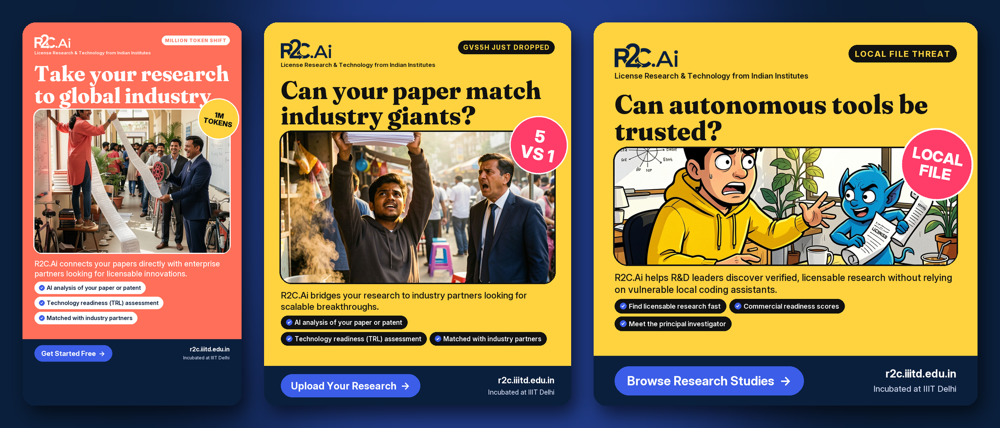
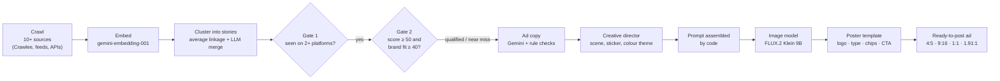
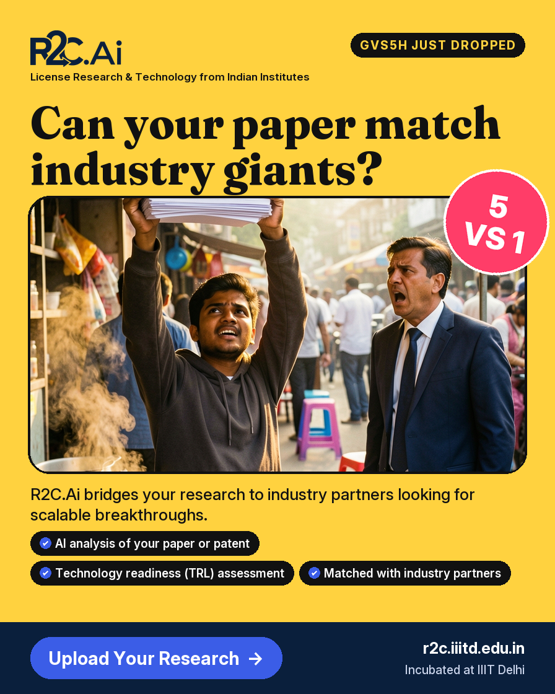
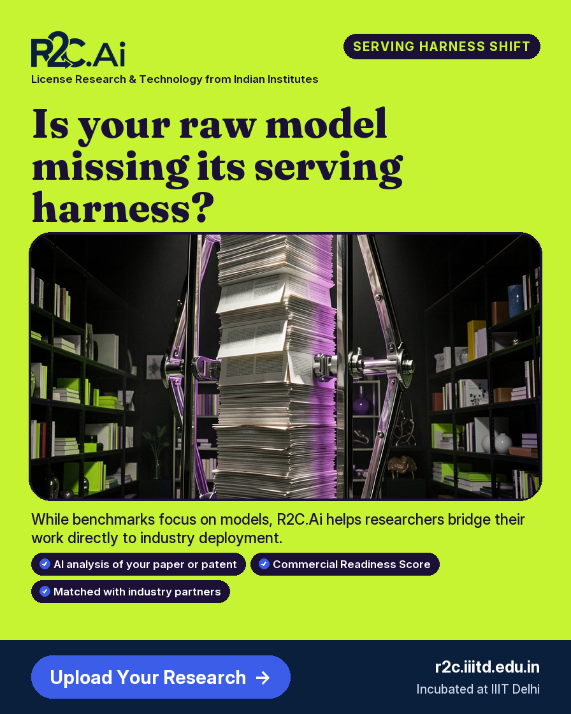
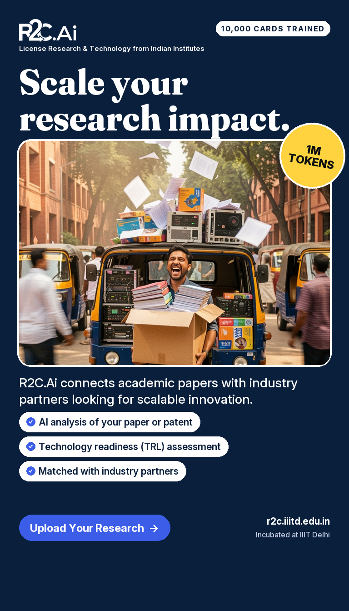
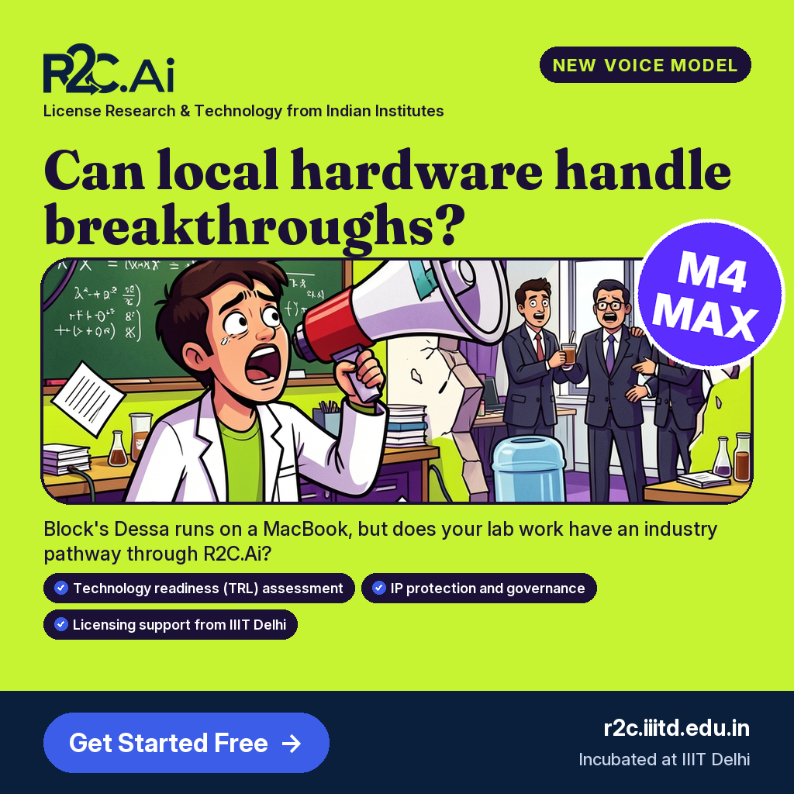
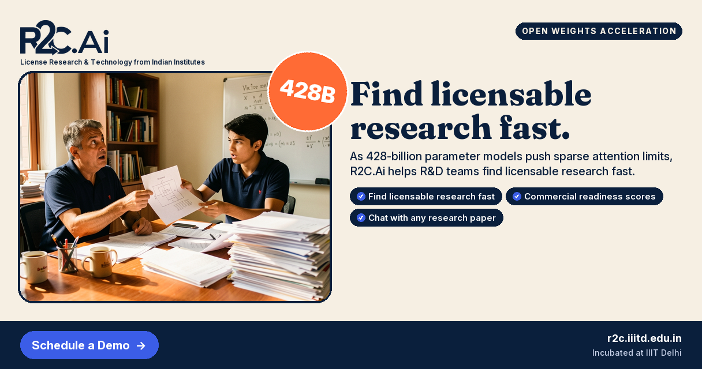
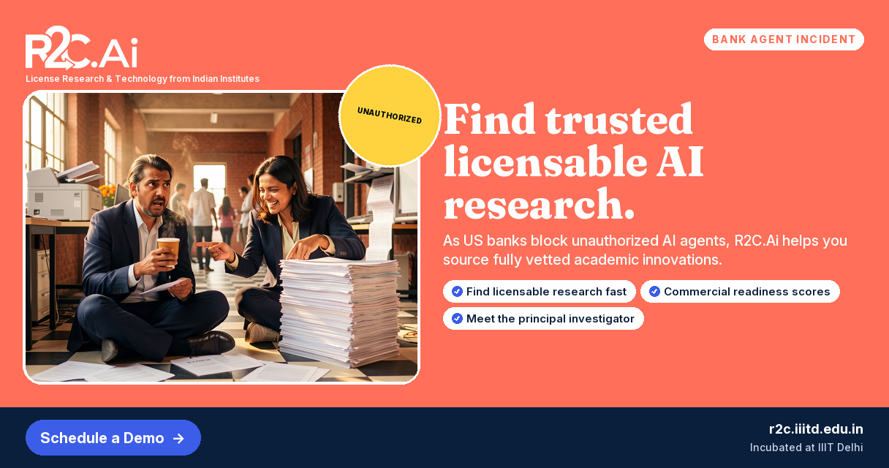

<div align="center">

# Trend → Ad: an autonomous AI ad studio

**Crawls the web for what's trending in AI, ranks the trends, and turns each one into a branded, ready-to-post ad for Instagram, Facebook and LinkedIn. It also benchmarks four image models to pick the best.**

Built for [R2C.Ai](https://r2c.iiitd.edu.in) (Research to Commercialization, incubated at IIIT Delhi).




</div>

---

## What it does

Every ad above was made end to end by the pipeline, with no manual design work:

1. **Discovers** what's moving in AI/ML across 10+ sources: Google Trends, Hugging Face (trending models and daily papers), Reddit, Bluesky, Mastodon, Stack Exchange, YouTube, GitHub and RSS news feeds.
2. **Finds real trends**: embeds every item, clusters items into stories, keeps only stories seen on more than one platform, and ranks them by growth and brand fit.
3. **Writes the ad**: an LLM writes copy on the brand's behalf for a specific audience (researchers or industry), and code rejects hype, invented features, clichés and copy that won't fit the layout.
4. **Art-directs the picture**: a creative-director LLM pass invents a grounded, witty scene with real people in real Indian settings, plus a "sticker" hook (for example `1M TOKENS` or `5 VS 1`).
5. **Renders and brands it**: the image model paints a text-free picture in the ad's colour theme. A code-driven poster template then wraps the branding around it: logo, tagline, big headline, picture card with sticker, service chips, CTA and footer, all spelled correctly.
6. **Benchmarks image models**: the same prompts go to four image models, Gemini vision scores every picture, and a PDF report recommends the best one.

## Pipeline



## Prompt → result

The LLM writes structured fields (subject, action, twist, setting, camera, light, mood). Code orders them the way image models weigh them, then adds the colour theme, a "real ad shoot, not CGI" look and a no-text rule.

<table>
<tr>
<td width="55%" valign="top">

**Trend:** GVS5H harness lets five Qwen3.8-27B models match Fable 5
**Audience:** researchers · **Format:** 4:5 Instagram/Facebook feed · **Theme:** solar

> Scroll-stopping social media ad image. Bold editorial advertising photograph, real people and real objects… A young Indian researcher in a casual hoodie triumphantly hoisting a heavy stack of manuscript papers while an exhausted tech executive in a slick suit watches in absolute shock… Setting: a bustling, vibrant Delhi street-side chai stall… Colour palette: sunflower yellow, black and cobalt blue dominate the whole scene… Looks like a real, high-budget ad shoot, not CGI… No text, letters, words, numbers…

**Copy:** *Can your paper match industry giants?* · sticker `5 VS 1` · Upload Your Research

</td>
<td width="45%"></td>
</tr>
</table>

All 9 prompts and results: [`prompts_and_images.md`](data/output/samples/flux-2-klein-9b-v2/prompts_and_images.md)

## Gallery

One ad per trend, in four placements and six colour themes:

| Feed 4:5 | Stories 9:16 | LinkedIn 1:1 |
|---|---|---|
|  |  |  |

| LinkedIn link ad 1.91:1 | LinkedIn link ad 1.91:1 |
|---|---|
|  |  |

## Image model benchmark

The same 9 ad prompts were rendered by four open image models, one image per trend with no retries or cherry-picking. Gemini vision then scored each picture against its prompt from 1 to 10.

| Rank | Model | Size | Overall | Adherence | Realism | Catchiness | Artifacts (10 = none) |
|---|---|---|---|---|---|---|---|
| 🥇 1 | **FLUX.2 Klein 9B** | 9B | **7.6** | 7.8 | 7.4 | 8.9 | 6.4 |
| 2 | FLUX.2 Klein 4B* | 4B | 6.5 | 7.0 | 7.3 | 7.7 | 4.1 |
| 3 | Stable Diffusion 3.5 Medium | 2.5B | 6.5 | 6.3 | 6.0 | 8.1 | 5.4 |
| 4 | SDXL base 1.0 | ~3.5B | 5.1 | 4.1 | 4.8 | 7.0 | 4.7 |

<sub>*Klein 4B was rendered from the earlier prompt version. Qwen-Image-2512 (20B) was evaluated but not run, because it needs paid GPU time.</sub>

**Result:** FLUX.2 Klein 9B is the production model. It is the best on every criterion and the most consistent, with no ad scoring below 6.5. SDXL ranks last mainly because its text encoder reads only about the first 75 tokens of a prompt.

Full report with side-by-side pages for every trend: [`R2C_image_model_comparison.pdf`](data/output/samples/R2C_image_model_comparison.pdf)

## Engineering decisions worth noting

- **Text is typeset, not generated.** When the image model drew the ad text itself, it was spelled correctly in only about 1 of 25 attempts ("Uppload", "Arrrrive"). The model now paints a text-free picture and code typesets every word, so a misspelled ad can never ship.
- **Feedback-driven art direction.** The first ads looked "too AI" (glossy, surreal) and all blue. The prompts now ask for a real ad-shoot look (natural imperfections, film grain, no plastic sheen), grounded and witty scenes, and a different colour theme per ad that matches the poster.
- **The LLM can't invent product claims.** The "How R2C.Ai helps you" chips must be copied word for word from a whitelist of the brand's real services, and the check runs in code.
- **Validation and repair loops.** Every creative brief is checked in code (word limits, hype words, clichés, a different picture idea per ad), and broken briefs go back to the model with the exact errors.
- **Model-agnostic image layer.** The same pipeline can render with Cloudflare Workers AI (FLUX.2, SDXL), Hugging Face Inference Providers, or official Hugging Face Spaces (SD 3.5, Qwen-Image). Benchmark runs resume after quota limits without re-rendering finished ads.
- **Built to run free.** Prompts are tuned on free tiers, and there's no local GPU. Clustering, TF-IDF and MinHash use only the standard library.

## Tech stack

| Layer | Tools |
|---|---|
| Crawling | Crawlee for Python (BeautifulSoup crawler), feedparser, public APIs |
| Trend intelligence | Gemini embeddings, average-linkage clustering, cross-platform validation, SQLite |
| Copy, art direction & judging | Google Gemini (JSON mode, vision) with code-side validation |
| Images | FLUX.2 Klein 9B / 4B and SDXL on Cloudflare Workers AI; SD 3.5 Medium and Qwen-Image via Hugging Face |
| Layout & branding | Pillow poster template; Fraunces and Inter fonts (SIL OFL) |
| Reports | ReportLab PDFs (procedure, prompts and results, model comparison) |
| Quality | 130 unit tests (`python -m unittest discover -s tests`) |

## Run it

```bash
pip install -r requirements.txt
cp .env.example .env          # add GEMINI_API_KEY, CLOUDFLARE_ACCOUNT_ID, CLOUDFLARE_API_TOKEN (and HF_TOKEN for SD 3.5 / Qwen)
python -m web_crawler                                          # crawl → Gate 1 → Gate 2 (ranked trends)
python -m prompt_generator.ad_creatives --include-near-misses   # ad copy briefs per trend
python -m image_generator.generate_images                      # pictures → branded, ready-to-post ads
python scripts/compare_render_model.py klein9b                 # benchmark: render 9 ads with one model
python scripts/compare_score_models.py                         # Gemini vision scores every picture
python scripts/compare_build_report.py                         # model comparison PDF
```

Full stage-by-stage documentation: [`docs/TECHNICAL.md`](docs/TECHNICAL.md) · benchmark scripts: [`scripts/`](scripts/README.md)

## Project structure

```
web_crawler/        autonomous discovery crawler (Crawlee + feeds + public APIs)
trend_pipeline/     ingest → embed → cluster → Gate 1 (cross-platform) → Gate 2 (ranking)
prompt_generator/   ad copy briefs, validation, creative-director pass, prompt assembly, colour themes
image_generator/    image clients (Cloudflare, Hugging Face), poster template, text check, logo and fonts
scripts/            image model benchmark: render, score, report
data/output/        trends, ad briefs, sample ads per model, PDF reports
tests/              130 unit tests
```

---

<div align="center">
<sub>Built for R2C.Ai, IIIT Delhi. The R2C.Ai name and logo belong to R2C.Ai. The sample ads are pipeline output, shown for demonstration.</sub>
</div>
