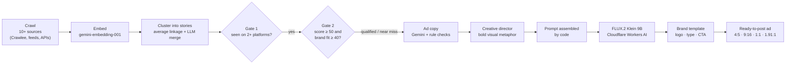
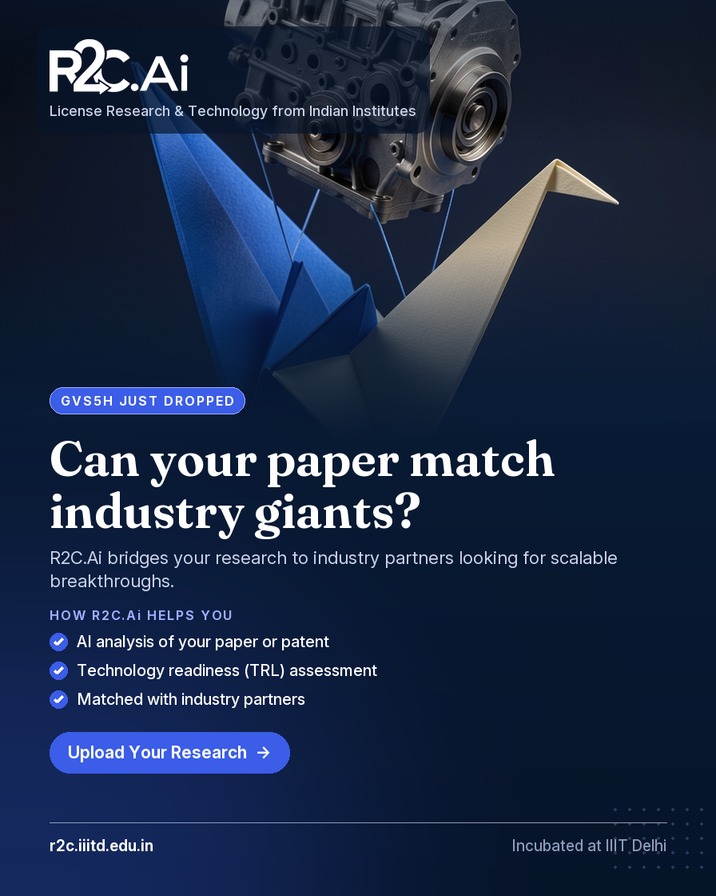
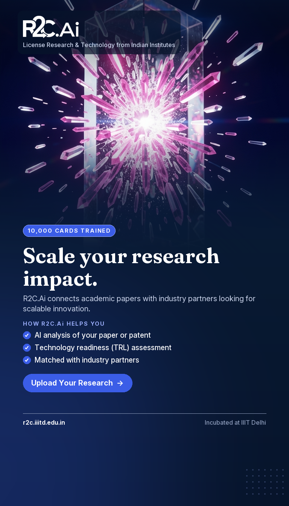
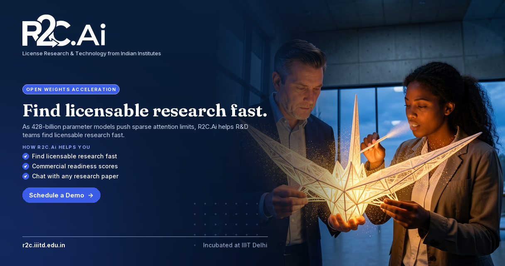

<div align="center">

# Trend → Ad: an autonomous AI ad studio

**Crawls the web for what's trending in AI, ranks the trends, and turns each one into a branded, ready-to-post ad for Instagram, Facebook and LinkedIn.**

Built for [R2C.Ai](https://r2c.iiitd.edu.in) (Research to Commercialization, incubated at IIIT Delhi).


</div>

---

## What it does

Every ad above was made end to end by the pipeline, with no manual design work:

1. **Discovers** what's moving in AI/ML across 10+ sources: Google Trends, Hugging Face (trending models and daily papers), Reddit, Bluesky, Mastodon, Stack Exchange, YouTube, GitHub and RSS news feeds.
2. **Finds real trends**: embeds every item, clusters items into stories, keeps only stories seen on more than one platform, and ranks them by growth and brand fit.
3. **Writes the ad**: an LLM writes copy on the brand's behalf for a specific audience (researchers or industry), and code rejects hype, invented features, clichés and copy that won't fit the layout.
4. **Art-directs the picture**: a second LLM pass acts as creative director and invents one bold visual metaphor per ad.
5. **Renders and brands it**: FLUX.2 Klein 9B paints the picture, then a code-driven brand template adds the official logo, typography, services, call to action and footer, all spelled correctly.

## Pipeline



## Prompt → result

For each ad, the prompt is assembled by code from the creative brief (style, subject, action, the surprising element, camera, light, brand colour grade, composition) and sent to the image model. The brand template then lays out the finished ad.

<table>
<tr>
<td width="55%" valign="top">

**Trend:** GVS5H harness lets five Qwen3.8-27B models match Fable 5
**Audience:** researchers · **Format:** 4:5 Instagram/Facebook feed

> Premium key visual for a 2026 tech-brand ad campaign. Editorial magazine-cover photograph, hyper-real detail, bold graphic composition… An intricate geometric crane folded from heavy-stock textured researcher manuscript paper. The paper crane holds the heavy steel engine block aloft with invisible tension, defying all physical expectations… Brand colour grade: deep navy (#0A1F3C) shadows and royal blue (#3B5DE7) light shape the whole scene… No text, letters, words, numbers, handwriting, logos…

**Copy:** *Can your paper match industry giants?* · Upload Your Research

</td>
<td width="45%"></td>
</tr>
</table>

All 9 prompts and results: [`prompts_and_images.md`](data/output/samples/flux-2-klein-9b/prompts_and_images.md) · full report: [`R2C_ad_samples_klein9b.pdf`](data/output/samples/flux-2-klein-9b/R2C_ad_samples_klein9b.pdf)

## Gallery

One ad per trend, in four placements:

| Feed 4:5 | Stories 9:16 | Feed 4:5 |
|---|---|---|
|  |  |  |

| LinkedIn link ad 1.91:1 | LinkedIn link ad 1.91:1 |
|---|---|
|  |  |

## Engineering decisions worth noting

- **Text is typeset, not generated.** When the image model drew the ad text itself, it was spelled correctly in only about 1 of 25 attempts ("Uppload", "Arrrrive"). The pipeline now asks the model for a text-free picture and typesets every word in code, so a misspelled ad can never ship. An optional "AI text" mode is still available: Gemini vision reads the text back, a misspelled ad is redrawn, and if it is still wrong the pipeline falls back to the typeset layout.
- **The LLM can't invent product claims.** The "How R2C.Ai helps you" points must be copied word for word from a whitelist of the brand's real services, and the check runs in code.
- **Validation and repair loops.** Every creative brief is checked in code (word limits, hype words, clichés such as glowing brains and robots, a different colour story per ad, people in conversion ads), and broken briefs go back to the model with the exact errors.
- **The prompt is assembled by code.** The LLM writes structured fields; code orders them the way FLUX weighs them (medium → subject → action → surprise → camera → light → colour) and adds brand colour grading and composition for each placement.
- **Built to run free.** Prompts are tuned on the free FLUX.2 Klein 4B tier, and finals are rendered on Klein 9B (about $0.015 per image). There's no local GPU and no heavy ML dependencies: clustering, TF-IDF and MinHash use only the standard library.
- **Robust to rate limits.** Gemini calls are paced and honour the server's "retry in N s" hint, and if embeddings hit a quota mid-run, clustering falls back to lexical vectors with their own threshold.

## Tech stack

| Layer | Tools |
|---|---|
| Crawling | Crawlee for Python (BeautifulSoup crawler), feedparser, public APIs |
| Trend intelligence | Gemini embeddings, average-linkage clustering, cross-platform validation, SQLite |
| Copy & art direction | Google Gemini (JSON mode) with code-side validation |
| Images | FLUX.2 Klein 9B / 4B on Cloudflare Workers AI |
| Layout & branding | Pillow; Fraunces and Inter fonts (SIL OFL) |
| Quality | 130 unit tests (`python -m unittest discover -s tests`) |

## Run it

```bash
pip install -r requirements.txt
cp .env.example .env          # add GEMINI_API_KEY, CLOUDFLARE_ACCOUNT_ID, CLOUDFLARE_API_TOKEN
python -m web_crawler                                          # crawl → Gate 1 → Gate 2 (ranked trends)
python -m prompt_generator.ad_creatives --include-near-misses   # ad copy briefs per trend
python -m image_generator.generate_images                      # pictures → branded, ready-to-post ads
python -m web_crawler --loop --interval 60                     # or run unattended, one cycle per hour
```

Full stage-by-stage documentation: [`docs/TECHNICAL.md`](docs/TECHNICAL.md).

## Project structure

```
web_crawler/        autonomous discovery crawler (Crawlee + feeds + public APIs)
trend_pipeline/     ingest → embed → cluster → Gate 1 (cross-platform) → Gate 2 (ranking)
prompt_generator/   ad copy briefs, validation, creative-director pass, prompt assembly
image_generator/    Cloudflare FLUX client, brand template, text check, assets (logo, fonts)
data/output/        trends, ad briefs, sample ads, PDF report
tests/              130 unit tests
```

---

<div align="center">
<sub>Built for R2C.Ai, IIIT Delhi. The R2C.Ai name and logo belong to R2C.Ai. The sample ads are pipeline output, shown for demonstration.</sub>
</div>
