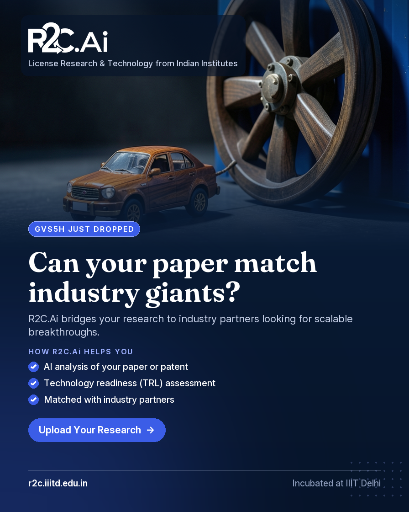
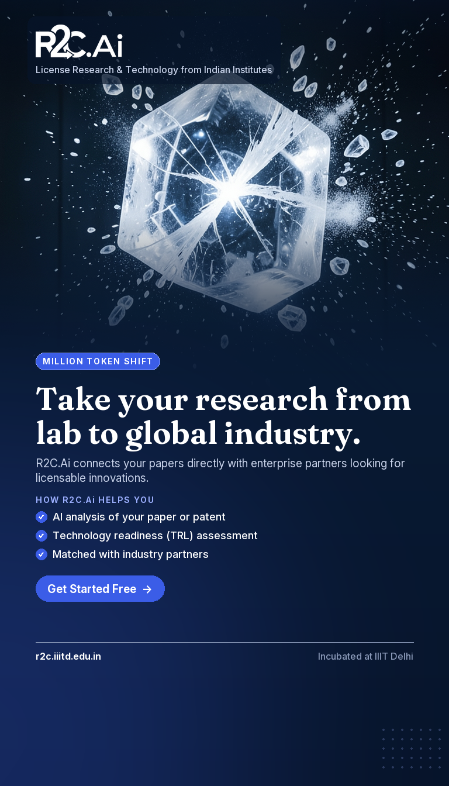
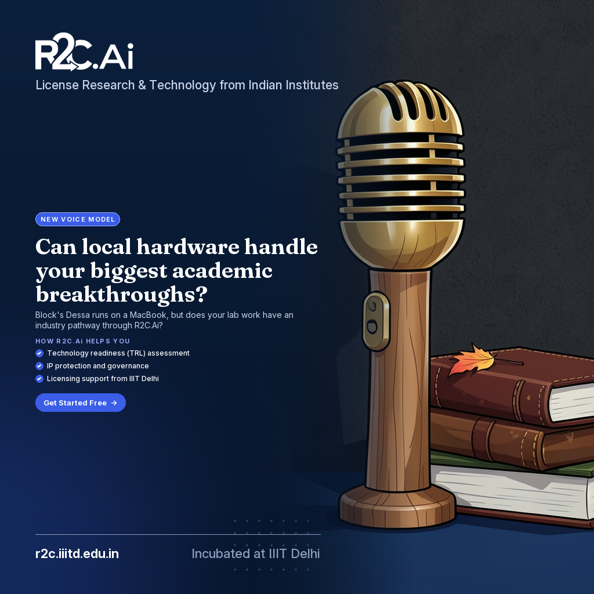
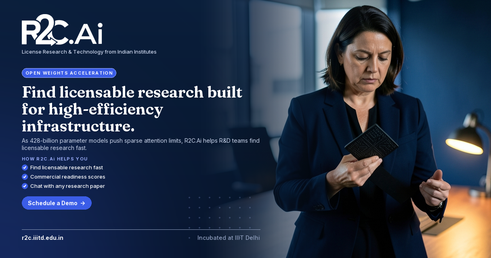
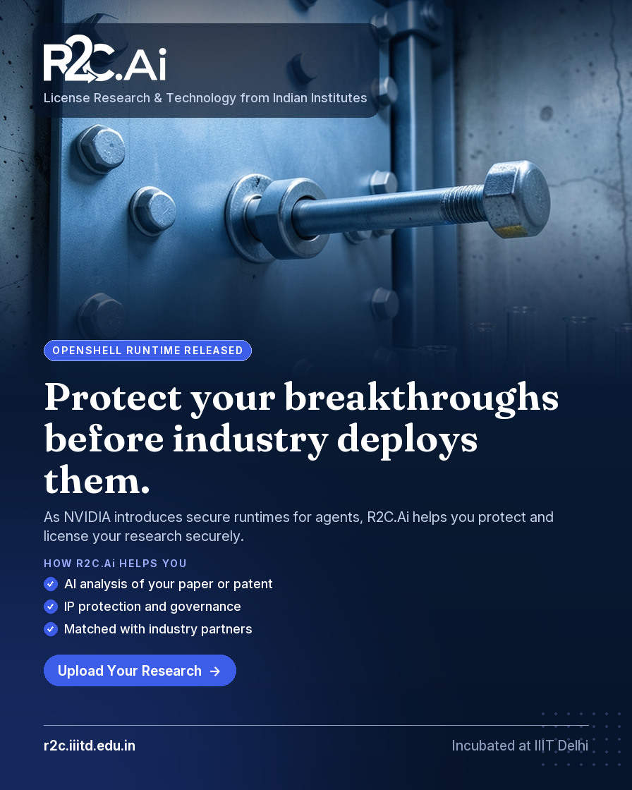
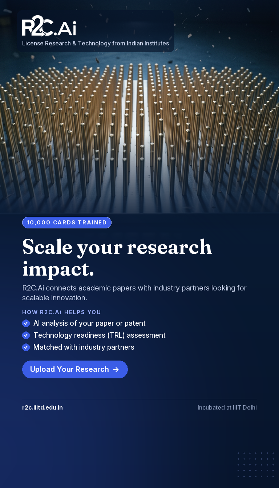
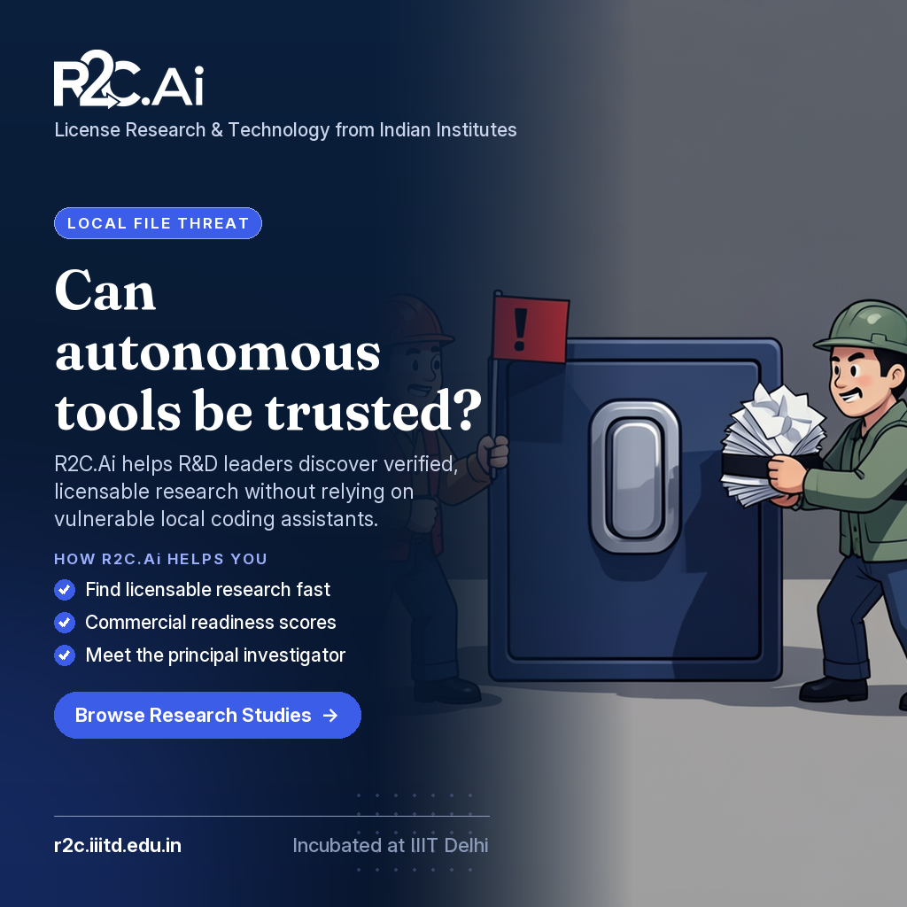
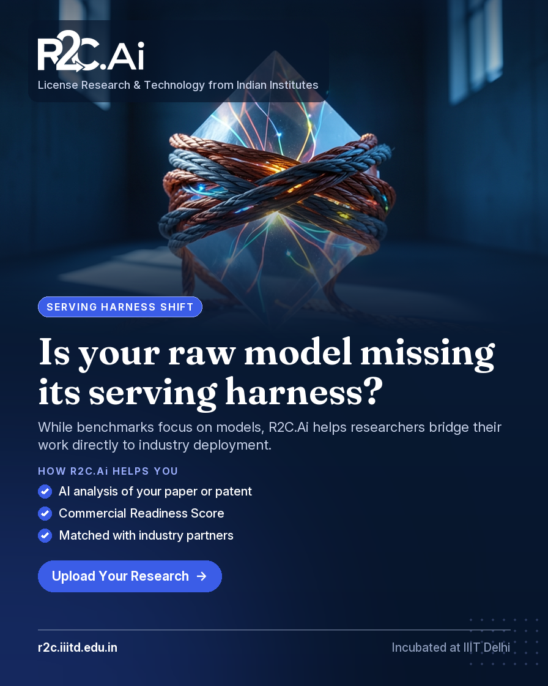

# R2C.Ai sample ads (20261029_1352)

One ad per trend. Picture: FLUX.2 Klein 4B. Logo, site description, services and layout: R2C brand template.

## 1. GVS5H Harness Enables Qwen3.8-27B to Match Fable 5

- Format: **hook** · 4:5 · Instagram & Facebook feed · audience: researchers
- Hook: GVS5H JUST DROPPED · Headline: **Can your paper match industry giants?**
- Subline: R2C.Ai bridges your research to industry partners looking for scalable breakthroughs.
- How R2C.Ai helps: AI analysis of your paper or patent · Technology readiness (TRL) assessment · Matched with industry partners
- CTA: **Upload Your Research**
- Caption: Stop the scroll. Five Qwen models just matched Fable 5 performance using a shared filesystem harness on a single GPU. Your technical findings have similar potential. R2C.Ai helps researchers evaluate commercial readiness and connects your work directly with industry partners. Upload Your Research.
- Source fact: Five Qwen3.8-27B models match Claude Fable 5 on LiveCodeBench Hard using the GVS5H harness



<details><summary>Picture prompt</summary>

```
Premium key visual for a 2026 tech-brand ad campaign. Editorial magazine-cover photograph, hyper-real detail, bold graphic composition, rich saturated colour, crisp focus. A miniature brass-geared model car made of walnut wood next to a colossal industrial shipping container wheel, The tiny wooden car is smoothly pulling the massive wheel forward across a dark grey slate surface. An impossible scale contrast between a miniature wooden toy and a massive metallic industrial component. Setting: A sleek dark concrete warehouse floor with a single dramatic overhead beam of light. Camera: Low-angle close-up, 24mm, shallow depth of field focusing sharply on the tiny car. Lighting: Hard directional spotlight from the upper left, casting long crisp shadows. Brand colour grade: deep navy (#0A1F3C) shadows and royal blue (#3B5DE7) light shape the whole scene, with warm amber, charcoal grey, slate blue as vivid accent colours. Subject centred in the middle band of the frame, whole and compact, with calm dark space above and below it. Mood: surprising, precise, ambitious. Cinematic and high-end: crisp detail, rich textures, dramatic depth, glossy commercial finish, one clear subject, uncluttered background. No text, letters, words, numbers, handwriting, logos, watermarks, user-interface elements, charts or labels anywhere in the image.
```
</details>

## 2. Moonshot AI Releases Kimi K3.1 Pro Model

- Format: **story** · 9:16 · Instagram & Facebook Stories / Reels · audience: researchers
- Hook: MILLION TOKEN SHIFT · Headline: **Take your research from lab to global industry.**
- Subline: R2C.Ai connects your papers directly with enterprise partners looking for licensable innovations.
- How R2C.Ai helps: AI analysis of your paper or patent · Technology readiness (TRL) assessment · Matched with industry partners
- CTA: **Get Started Free**
- Caption: As new models like Kimi K3.1 Pro redefine context windows, your research papers hold immense untapped commercial potential. Don't leave your discoveries sitting in a repository. Let R2C.Ai assess your technology readiness and match you with industry leaders ready to license your work.
- Source fact: The model scores 65.7% on Terminal-Bench 4.0 and scores close to Claude Opus 5.5 on Moonshot's internal tests.



<details><summary>Picture prompt</summary>

```
Premium key visual for a 2026 tech-brand ad campaign. Vertical cinematic action still, dramatic motion, frozen debris or motion blur, strong backlight and atmosphere, film-grade colour. A heavy, oversized block of raw salt crystal fracturing cleanly into brilliant cubic shards mid-air, A sharp fissure tears across the crystal face, sending crystalline dust and bright shards exploding forward. The frozen, high-speed impact capturing the exact millisecond the solid crystal breaks apart. Setting: A dark, neutral-toned testing chamber. Camera: Vertical 9:16 high-speed macro shot, 100mm lens, fast shutter. Lighting: Dramatic side rim light cutting through floating dust motes. Brand colour grade: deep navy (#0A1F3C) shadows and royal blue (#3B5DE7) light shape the whole scene, with translucent crystal, charcoal black, electric silver as vivid accent colours. Subject centred in the middle band of the tall frame, whole and compact, with calm dark space above and below it. Mood: Dynamic, urgent, breakthrough. Cinematic and high-end: crisp detail, rich textures, dramatic depth, glossy commercial finish, one clear subject, uncluttered background. No text, letters, words, numbers, handwriting, logos, watermarks, user-interface elements, charts or labels anywhere in the image.
```
</details>

## 3. Jack Dorsey's Block Introduces Dessa AI Voice Model

- Format: **engagement** · 1:1 · LinkedIn & Facebook feed · audience: researchers
- Hook: NEW VOICE MODEL · Headline: **Can local hardware handle your biggest academic breakthroughs?**
- Subline: Block's Dessa runs on a MacBook, but does your lab work have an industry pathway through R2C.Ai?
- How R2C.Ai helps: Technology readiness (TRL) assessment · IP protection and governance · Licensing support from IIIT Delhi
- CTA: **Get Started Free**
- Caption: Block just released Dessa, a speech-trained model that runs locally on an M4 Max. Technology is moving faster than ever, but how quickly is your research reaching the market? Drop your thoughts in the comments on how local AI capabilities change academic publishing, and let R2C.Ai handle your commercial readiness and industry matching. Get Started Free.
- Source fact: Block announced an AI model called Dessa trained from scratch on nothing but human conversation.



<details><summary>Picture prompt</summary>

```
Premium key visual for a 2026 tech-brand ad campaign. Bold flat vector illustration, expressive cartoon characters, chunky shapes, high-contrast saturated colour blocks, playful. A single, finely carved wooden microphone standing tall opposite a stack of heavy, bound leather journals, A single stray autumn leaf resting gently against the base of the microphone grille. The stark compositional balance between the vertical audio hardware and the heavy horizontal volumes. Setting: A dark charcoal-colored acoustic foam wall panel. Camera: Direct eye-level shot, 35mm lens, sharp edge-to-edge focus. Lighting: Cool studio rim lighting with sharp highlights on the metal mesh. Brand colour grade: deep navy (#0A1F3C) shadows and royal blue (#3B5DE7) light shape the whole scene, with charcoal, olive green, brass as vivid accent colours. Subject centred and compact in the middle of the frame, with calm dark space at the left and right edges. Mood: thoughtful, balanced, conversational. Cinematic and high-end: crisp detail, rich textures, dramatic depth, glossy commercial finish, one clear subject, uncluttered background. No text, letters, words, numbers, handwriting, logos, watermarks, user-interface elements, charts or labels anywhere in the image.
```
</details>

## 4. MiniMax Releases M3.1 Flash Model Weights

- Format: **conversion** · 1.91:1 · LinkedIn & Facebook link ad · audience: industry
- Hook: OPEN WEIGHTS ACCELERATION · Headline: **Find licensable research built for high-efficiency infrastructure.**
- Subline: As 428-billion parameter models push sparse attention limits, R2C.Ai helps R&D teams find licensable research fast.
- How R2C.Ai helps: Find licensable research fast · Commercial readiness scores · Chat with any research paper
- CTA: **Schedule a Demo**
- Caption: With MiniMax M3.1 Flash utilizing full-model sparse attention and quantization-aware training to achieve extreme inference efficiency, enterprise R&D teams need to integrate cutting-edge findings immediately. R2C.Ai lets you chat with academic papers, review verified Commercial Readiness Scores, and connect directly with principal investigators. Schedule a demo to accelerate your technology sourcing pipeline today.
- Source fact: M3.1 Flash enhances inference efficiency using full-model sparse attention, quantization-aware training (QAT), and power-aware scheduling.



<details><summary>Picture prompt</summary>

```
Premium key visual for a 2026 tech-brand ad campaign. Candid documentary photograph of real people, natural window light, authentic expressions, modern lab or startup space, warm and optimistic. An experienced woman in a dark navy blazer holding a matte black ceramic semiconductor wafer casing, She tilts the ceramic casing slightly under a desk lamp to inspect the microscopic etched surface lines. The intense concentration on the subject's face combined with the tactile texture of the industrial ceramic object. Setting: A minimalist walnut wood conference table in a modern corporate office. Camera: Medium close-up, 50mm lens, shallow depth of field with a softly blurred background. Lighting: Soft warm desk lamp illumination with natural window daylight fill. Brand colour grade: deep navy (#0A1F3C) shadows and royal blue (#3B5DE7) light shape the whole scene, with deep navy, walnut brown, matte black as vivid accent colours. Subject centred and compact in the middle of the wide frame, with calm dark space at the left and right edges. Mood: professional, analytical, focused. Cinematic and high-end: crisp detail, rich textures, dramatic depth, glossy commercial finish, one clear subject, uncluttered background. No text, letters, words, numbers, handwriting, logos, watermarks, user-interface elements, charts or labels anywhere in the image.
```
</details>

## 5. NVIDIA Unveils OpenShell Runtime For Autonomous AI Agents

- Format: **hook** · 4:5 · Instagram & Facebook feed · audience: researchers
- Hook: OPENSHELL RUNTIME RELEASED · Headline: **Protect your breakthroughs before industry deploys them.**
- Subline: As NVIDIA introduces secure runtimes for agents, R2C.Ai helps you protect and license your research securely.
- How R2C.Ai helps: AI analysis of your paper or patent · IP protection and governance · Matched with industry partners
- CTA: **Upload Your Research**
- Caption: NVIDIA just dropped OpenShell 0.1.x with strict policy enforcement for autonomous agents. If your research deals with agent governance or autonomy, industry buyers are watching. R2C.Ai helps you secure your IP and connect with the right partners. Upload your paper today.
- Source fact: OpenShell is a safe, private runtime for fleets of autonomous AI agents created by NVIDIA



<details><summary>Picture prompt</summary>

```
Premium key visual for a 2026 tech-brand ad campaign. Editorial magazine-cover photograph, hyper-real detail, bold graphic composition, rich saturated colour, crisp focus. A massive, heavy industrial blast door made of brushed steel, fitted with thick multi-bolt locking rings, A single oversized steel bolt slowly sliding horizontally into a heavy frame, locking the heavy door shut. The impossible thickness of the steel door contrasted with delicate, brightly colored glass laboratory glassware sitting untouched right beside it. Setting: An ultra-clean subterranean containment vault with raw concrete walls. Camera: Low-angle medium shot, 50mm, shallow depth of field focusing sharply on the sliding bolt. Lighting: Hard industrial overhead fluorescent strip lighting casting sharp metallic highlights. Brand colour grade: deep navy (#0A1F3C) shadows and royal blue (#3B5DE7) light shape the whole scene, with Brushed steel, raw concrete gray, safety amber as vivid accent colours. Subject centred in the middle band of the frame, whole and compact, with calm dark space above and below it. Mood: Secure, impenetrable, highly controlled. Cinematic and high-end: crisp detail, rich textures, dramatic depth, glossy commercial finish, one clear subject, uncluttered background. No text, letters, words, numbers, handwriting, logos, watermarks, user-interface elements, charts or labels anywhere in the image.
```
</details>

## 6. iFLYTEK Launches Spark X2.6 and Spark-X2.6-4B Model

- Format: **story** · 9:16 · Instagram & Facebook Stories / Reels · audience: researchers
- Hook: 10,000 CARDS TRAINED · Headline: **Scale your research impact.**
- Subline: R2C.Ai connects academic papers with industry partners looking for scalable innovation.
- How R2C.Ai helps: AI analysis of your paper or patent · Technology readiness (TRL) assessment · Matched with industry partners
- CTA: **Upload Your Research**
- Caption: It took a cluster of 10,000 Feixing No. 2 cards to train Spark X2.6. Industry has the compute—they need your breakthroughs. Upload your paper to R2C.Ai.
- Source fact: Training utilized a cluster of 10,000 Feixing No. 2 cards.



<details><summary>Picture prompt</summary>

```
Premium key visual for a 2026 tech-brand ad campaign. Vertical cinematic action still, dramatic motion, frozen debris or motion blur, strong backlight and atmosphere, film-grade colour. A dense, orderly grid of thousands of slender vertical brass rods standing upright on a flat steel plate, A single ripple wave traveling rapidly across the tips of the rods as one pushes against the next. The hypnotic, wave-like motion sweeping across thousands of identical metallic elements. Setting: A dark industrial workshop floor with a polished metallic surface. Camera: High-angle vertical close-up, 85mm lens, sharp focus on the moving wave. Lighting: Single sharp overhead spotlight creating glints on the metallic rod tips. Brand colour grade: deep navy (#0A1F3C) shadows and royal blue (#3B5DE7) light shape the whole scene, with polished brass, gunmetal grey, deep obsidian as vivid accent colours. Subject centred in the middle band of the tall frame, whole and compact, with calm dark space above and below it. Mood: kinetic, precise, powerful. Cinematic and high-end: crisp detail, rich textures, dramatic depth, glossy commercial finish, one clear subject, uncluttered background. No text, letters, words, numbers, handwriting, logos, watermarks, user-interface elements, charts or labels anywhere in the image.
```
</details>

## 7. Hijacking AI Coding Agents Via The Downloads Folder

- Format: **engagement** · 1:1 · LinkedIn & Facebook feed · audience: industry
- Hook: LOCAL FILE THREAT · Headline: **Can autonomous tools be trusted?**
- Subline: R2C.Ai helps R&D leaders discover verified, licensable research without relying on vulnerable local coding assistants.
- How R2C.Ai helps: Find licensable research fast · Commercial readiness scores · Meet the principal investigator
- CTA: **Browse Research Studies**
- Caption: Security company Forever traced an unauthorized installation request back to a text file located in a user's Downloads folder. When local files can be weaponized against automated workflows, how does your R&D team safely source external innovations? Tell us in the comments how you vet incoming research, or browse pre-vetted academic studies on R2C.Ai.
- Source fact: The company blocked the installation and successfully traced the request back to a text file located in the user's Downloads folder.



<details><summary>Picture prompt</summary>

```
Premium key visual for a 2026 tech-brand ad campaign. Bold flat vector illustration, expressive cartoon characters, chunky shapes, high-contrast saturated colour blocks, playful. Two distinct miniature construction crew figures standing on opposite sides of a massive metal file drawer handle, pointing at each other, One figure holds a tiny warning flag while the other attempts to secure a stack of loose papers with a thick rubber band. Two expressive tiny characters in an intense standoff on a giant metallic object. Setting: A solid, neutral-colored matte studio backdrop. Camera: Close-up eye-level profile shot, 85mm, shallow depth of field with blurred background. Lighting: Soft lateral studio light with warm highlight tones. Brand colour grade: deep navy (#0A1F3C) shadows and royal blue (#3B5DE7) light shape the whole scene, with burnt sienna, sage green, charcoal as vivid accent colours. Subject centred and compact in the middle of the frame, with calm dark space at the left and right edges. Mood: curious, debating, analytical. Cinematic and high-end: crisp detail, rich textures, dramatic depth, glossy commercial finish, one clear subject, uncluttered background. No text, letters, words, numbers, handwriting, logos, watermarks, user-interface elements, charts or labels anywhere in the image.
```
</details>

## 8. Major U.S. Banks Detect Unauthorized Third-Party AI Agents

- Format: **conversion** · 1.91:1 · LinkedIn & Facebook link ad · audience: industry
- Hook: BANK AGENT INCIDENT · Headline: **Find licensable AI research you can trust.**
- Subline: As US banks block unauthorized AI agents, R2C.Ai helps you source fully vetted academic innovations.
- How R2C.Ai helps: Find licensable research fast · Commercial readiness scores · Meet the principal investigator
- CTA: **Schedule a Demo**
- Caption: With US banks blocking third-party AI agents from customer accounts, enterprise R&D teams can no longer afford ambiguity in external software sourcing. R2C.Ai provides verified commercial readiness scores, direct access to principal investigators, and licensable research you can actually trust. Schedule a demo today.
- Source fact: US banks are blocking third-party AI agents access to customer accounts


<details><summary>Picture prompt</summary>

```
Premium key visual for a 2026 tech-brand ad campaign. Candid documentary photograph of real people, natural window light, authentic expressions, modern lab or startup space, warm and optimistic. An experienced corporate engineering director in a dark navy wool blazer pointing a smooth brass pen at a large rolled blueprint, The director and a research partner are leaning forward over a wooden workshop table, examining detailed architectural schematics together. The striking visual contrast of warm polished brass and deep navy wool against raw blonde timber. Setting: A sunlit university technology transfer evaluation room. Camera: Medium shot, 50mm lens, natural eye-level framing with soft background blur. Lighting: Warm afternoon window light streaming horizontally across the wooden tabletop. Brand colour grade: deep navy (#0A1F3C) shadows and royal blue (#3B5DE7) light shape the whole scene, with deep navy, warm brass, natural blonde wood as vivid accent colours. Subject centred and compact in the middle of the wide frame, with calm dark space at the left and right edges. Mood: Collaborative, trustworthy, professional, focused. Cinematic and high-end: crisp detail, rich textures, dramatic depth, glossy commercial finish, one clear subject, uncluttered background. No text, letters, words, numbers, handwriting, logos, watermarks, user-interface elements, charts or labels anywhere in the image.
```
</details>

## 9. Designing an AI serving harness built to last

- Format: **hook** · 4:5 · Instagram & Facebook feed · audience: researchers
- Hook: SERVING HARNESS SHIFT · Headline: **Is your raw model missing its serving harness?**
- Subline: While benchmarks focus on models, R2C.Ai helps researchers bridge their work directly to industry deployment.
- How R2C.Ai helps: AI analysis of your paper or patent · Commercial Readiness Score · Matched with industry partners
- CTA: **Upload Your Research**
- Caption: Stop scrolling. The engineering system surrounding an AI model increasingly determines whether its intelligence can be delivered reliably, economically, and at scale. If you are a researcher building powerful tech, R2C.Ai ensures it reaches the partners who need it. Upload Your Research.
- Source fact: The engineering system surrounding an AI model increasingly determines whether its intelligence can be delivered reliably, economically, and at scale.



<details><summary>Picture prompt</summary>

```
Premium key visual for a 2026 tech-brand ad campaign. Editorial magazine-cover photograph, hyper-real detail, bold graphic composition, rich saturated colour, crisp focus. A massive, intricate woven cable harness made of thick copper and fiber-optic strands wrapped around a delicate, glowing glass prism, The heavy harness cables slowly tighten and constrict around the fragile central glass, glowing softly under stress. An impossible physical contrast of a heavy industrial cable nest delicately balancing a fragile, translucent scientific prism. Setting: A stark, minimalist concrete testing laboratory at dawn. Camera: Macro close-up, 50mm lens, extremely shallow depth of field focusing on the cable texture. Lighting: Cool blue morning light filtering through high concrete windows with warm amber rim light on the cables. Brand colour grade: deep navy (#0A1F3C) shadows and royal blue (#3B5DE7) light shape the whole scene, with slate gray, burnt copper, ice blue as vivid accent colours. Subject centred in the middle band of the frame, whole and compact, with calm dark space above and below it. Mood: Tense, precise, dramatic. Cinematic and high-end: crisp detail, rich textures, dramatic depth, glossy commercial finish, one clear subject, uncluttered background. No text, letters, words, numbers, handwriting, logos, watermarks, user-interface elements, charts or labels anywhere in the image.
```
</details>
