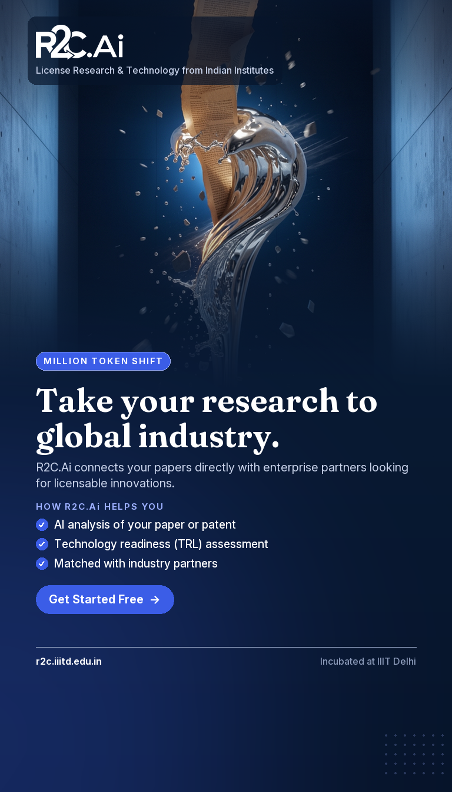
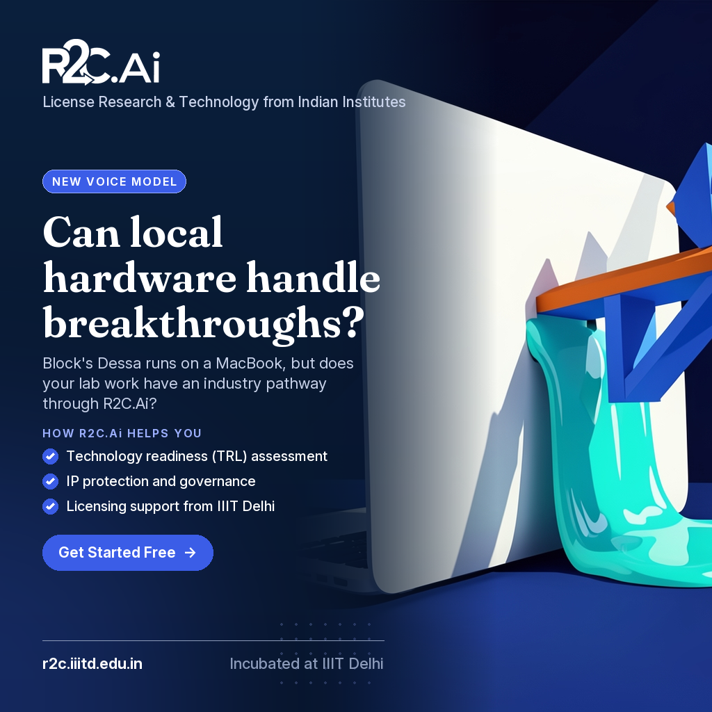
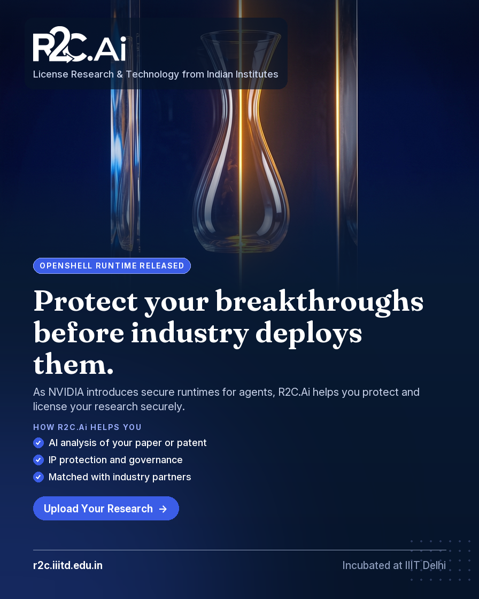
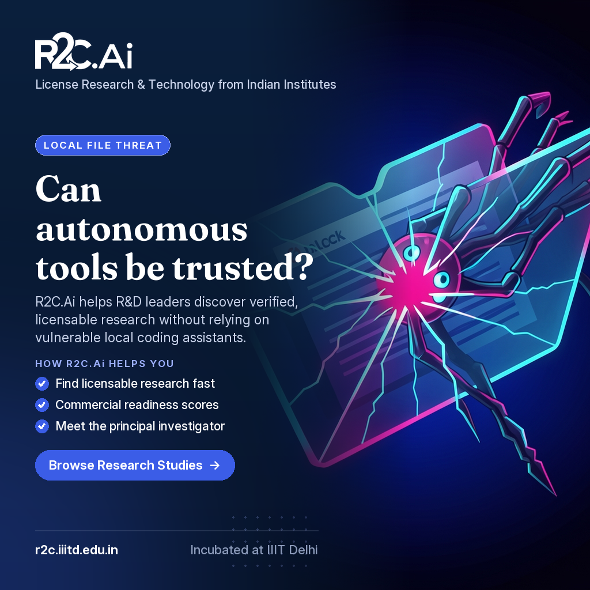
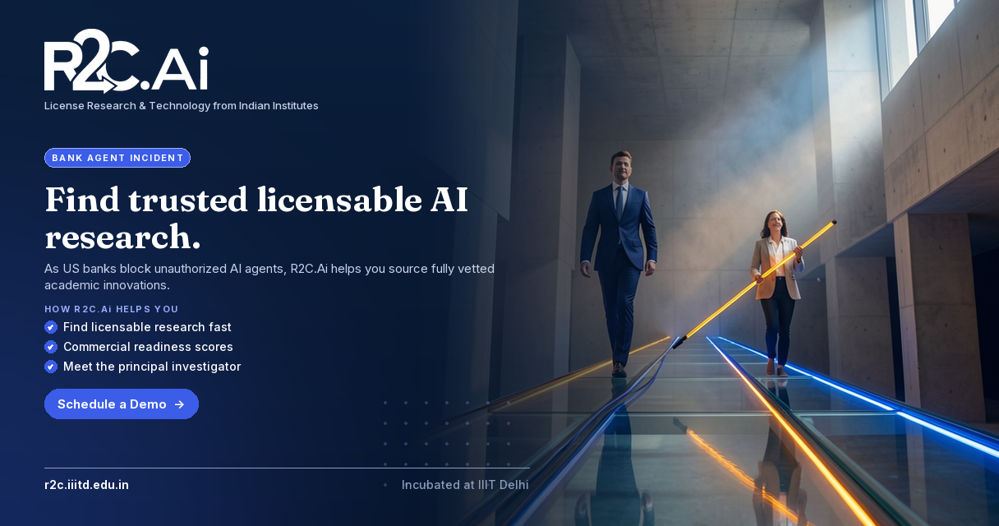
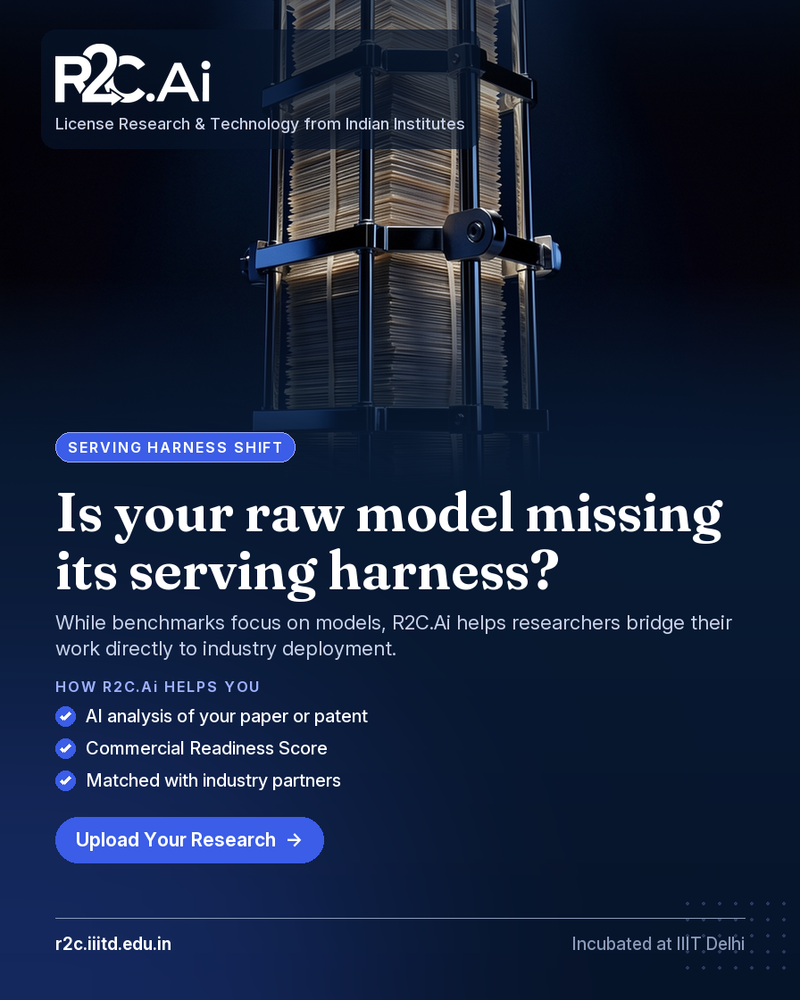

# R2C.Ai sample ads: FLUX.2 Klein 9B

Same approved copy as samples/20261029_1352, with a bolder picture from a creative-director pass. Picture: FLUX.2 Klein 9B (Cloudflare). Logo, text and layout: R2C brand template.

## 1. GVS5H Harness Enables Qwen3.8-27B to Match Fable 5

- Format: **hook** · 4:5 · Instagram & Facebook feed · audience: researchers
- Hook: GVS5H JUST DROPPED · Headline: **Can your paper match industry giants?**
- Subline: R2C.Ai bridges your research to industry partners looking for scalable breakthroughs.
- How R2C.Ai helps: AI analysis of your paper or patent · Technology readiness (TRL) assessment · Matched with industry partners
- CTA: **Upload Your Research**
- Picture idea (new): A single delicate origami crane effortlessly lifting a massive, hyper-detailed raw industrial engine block, embodying the GVS5H breakthrough of small models matching giants.
- Picture idea (before): A tiny wind-up wooden token pulling a massive polished steel chassis across a slate floor, representing small models outperforming massive ones.
- Status: success


<details><summary>Picture prompt</summary>

```
Premium key visual for a 2026 tech-brand ad campaign. Editorial magazine-cover photograph, hyper-real detail, bold graphic composition, rich saturated colour, crisp focus. An intricate geometric crane folded from heavy-stock textured researcher manuscript paper, The paper crane holds the heavy steel engine block aloft with invisible tension, defying all physical expectations. An impossible, gravity-defying weight disparity between a fragile paper artifact and industrial heavy machinery. Setting: A minimalist architectural space with a matte finish and infinite depth. Camera: Macro shot, 50mm macro lens, ultra-sharp focus on the paper texture against a soft atmospheric background. Lighting: Dramatically sculpted side-lighting emphasizing the fibrous texture of the paper contrasting with cold, brushed steel. Brand colour grade: deep navy (#0A1F3C) shadows and royal blue (#3B5DE7) light shape the whole scene, with deep navy, royal blue, raw titanium, warm ivory as vivid accent colours. Subject centred in the middle band of the frame, whole and compact, with calm dark space above and below it. Mood: surreal, sophisticated, disruptive. Cinematic and high-end: crisp detail, rich textures, dramatic depth, glossy commercial finish, one clear subject, uncluttered background. No text, letters, words, numbers, handwriting, logos, watermarks, user-interface elements, charts or labels anywhere in the image.
```
</details>

## 2. Moonshot AI Releases Kimi K3.1 Pro Model

- Format: **story** · 9:16 · Instagram & Facebook Stories / Reels · audience: researchers
- Hook: MILLION TOKEN SHIFT · Headline: **Take your research to global industry.**
- Subline: R2C.Ai connects your papers directly with enterprise partners looking for licensable innovations.
- How R2C.Ai helps: AI analysis of your paper or patent · Technology readiness (TRL) assessment · Matched with industry partners
- CTA: **Get Started Free**
- Picture idea (new): A massive 1-million-token scroll of traditional academic paper unrolls infinitely, instantly transforming into sleek, reflective chrome sheets as it catches an industrial light source.
- Picture idea (before): A moment of sudden, explosive momentum breaking through physical limits, symbolizing academic research bursting into commercial reality.
- Status: success



<details><summary>Picture prompt</summary>

```
Premium key visual for a 2026 tech-brand ad campaign. Vertical cinematic action still, dramatic motion, frozen debris or motion blur, strong backlight and atmosphere, film-grade colour. A towering, impossibly thin column of aged vellum paper morphing mid-air into highly polished liquid metal, A colossal wave of heavy parchment breaks cleanly against an invisible threshold, dissolving into a stream of molten silver that pours directly outward. The impossible mid-air transition of dry, crackling paper turning into mirror-like liquid mercury against a void. Setting: A cavernous, ultra-minimalist concrete architectural space with infinite vertical depth. Camera: Vertical 9:16 ultra-wide cinematic perspective, 35mm anamorphic lens, hyper-detailed textures. Lighting: Deep royal blue ambient wash pierced by a sharp, warm amber rim light catching the metal edges. Brand colour grade: deep navy (#0A1F3C) shadows and royal blue (#3B5DE7) light shape the whole scene, with deep navy, royal blue, aged parchment, polished chrome, warm amber as vivid accent colours. Subject centred in the middle band of the tall frame, whole and compact, with calm dark space above and below it. Mood: Monumental, transformative, hyper-premium. Cinematic and high-end: crisp detail, rich textures, dramatic depth, glossy commercial finish, one clear subject, uncluttered background. No text, letters, words, numbers, handwriting, logos, watermarks, user-interface elements, charts or labels anywhere in the image.
```
</details>

## 3. Jack Dorsey's Block Introduces Dessa AI Voice Model

- Format: **engagement** · 1:1 · LinkedIn & Facebook feed · audience: researchers
- Hook: NEW VOICE MODEL · Headline: **Can local hardware handle breakthroughs?**
- Subline: Block's Dessa runs on a MacBook, but does your lab work have an industry pathway through R2C.Ai?
- How R2C.Ai helps: Technology readiness (TRL) assessment · IP protection and governance · Licensing support from IIIT Delhi
- CTA: **Get Started Free**
- Picture idea (new): An impossible, surreal scale shift where an enormous, glossy porcelain MacBook rests delicately on the palm of a giant, stylized researcher's hand, while a vibrant liquid voice wave pours out of the laptop like molten glass into a waiting factory skyline below.
- Picture idea (before): A visual standoff representing local resource capability versus massive conversational data.
- Status: success



<details><summary>Picture prompt</summary>

```
Premium key visual for a 2026 tech-brand ad campaign. Bold flat vector illustration, expressive cartoon characters, chunky shapes, high-contrast saturated colour blocks, playful. A massive, pristine white porcelain MacBook with chunky, bold geometry, A thick, luminous ribbon of turquoise liquid voice-wave spills over the laptop edge, transforming mid-air into solid geometric bridges connecting academia to industry. The surreal physics of liquid porcelain and the stark contrast of giant scale against a minimalist background. Setting: An infinite, clean studio space stripped of clutter, focusing entirely on the monumental hand and laptop. Camera: Low-angle wide shot, 24mm perspective, dramatic upward tilt emphasizing scale. Lighting: High-contrast directional studio lighting with sharp specular highlights and deep, rich shadows. Brand colour grade: deep navy (#0A1F3C) shadows and royal blue (#3B5DE7) light shape the whole scene, with deep navy, royal blue, porcelain white, vibrant turquoise, burnt orange as vivid accent colours. Subject centred and compact in the middle of the frame, with calm dark space at the left and right edges. Mood: audacious, imaginative, premium, cinematic. Cinematic and high-end: crisp detail, rich textures, dramatic depth, glossy commercial finish, one clear subject, uncluttered background. No text, letters, words, numbers, handwriting, logos, watermarks, user-interface elements, charts or labels anywhere in the image.
```
</details>

## 4. MiniMax Releases M3.1 Flash Model Weights

- Format: **conversion** · 1.91:1 · LinkedIn & Facebook link ad · audience: industry
- Hook: OPEN WEIGHTS ACCELERATION · Headline: **Find licensable research fast.**
- Subline: As 428-billion parameter models push sparse attention limits, R2C.Ai helps R&D teams find licensable research fast.
- How R2C.Ai helps: Find licensable research fast · Commercial readiness scores · Chat with any research paper
- CTA: **Schedule a Demo**
- Picture idea (new): A colossal origami crane constructed from glowing, semi-transparent architectural blue-prints rests delicately in the palm of an industry R&D leader, symbolizing massive scale folded into hyper-efficient structure.
- Picture idea (before): A focused corporate R&D leader examining physical evidence of new technology in a professional setting.
- Status: success


<details><summary>Picture prompt</summary>

```
Premium key visual for a 2026 tech-brand ad campaign. Candid documentary photograph of real people, natural window light, authentic expressions, modern lab or startup space, warm and optimistic. A diverse duo of a corporate engineering director and an academic researcher, looking down with intense awe at the impossibly intricate paper creation, The researcher gently blows a soft breath across the paper crane, causing delicate particles of golden light to shed off its wings like efficient data discharge. The surreal contrast of holding a colossal, complex architectural structure folded down into a weightless, glowing origami object in an ordinary room. Setting: A stark, brutalist concrete R&D atrium with towering glass windows at twilight. Camera: Wide dynamic-range shot, 35mm lens, sharp focus on the glowing paper texture against a moody architectural backdrop. Lighting: The primary light source emanates entirely from the glowing paper structure itself, casting amber and electric blue reflections onto their faces. Brand colour grade: deep navy (#0A1F3C) shadows and royal blue (#3B5DE7) light shape the whole scene, with electric blue, deep navy, burnt amber, concrete grey as vivid accent colours. Subject centred and compact in the middle of the wide frame, with calm dark space at the left and right edges. Mood: surreal, breathtaking, visionary, precise. Cinematic and high-end: crisp detail, rich textures, dramatic depth, glossy commercial finish, one clear subject, uncluttered background. No text, letters, words, numbers, handwriting, logos, watermarks, user-interface elements, charts or labels anywhere in the image.
```
</details>

## 5. NVIDIA Unveils OpenShell Runtime For Autonomous AI Agents

- Format: **hook** · 4:5 · Instagram & Facebook feed · audience: researchers
- Hook: OPENSHELL RUNTIME RELEASED · Headline: **Protect your breakthroughs before industry deploys them.**
- Subline: As NVIDIA introduces secure runtimes for agents, R2C.Ai helps you protect and license your research securely.
- How R2C.Ai helps: AI analysis of your paper or patent · IP protection and governance · Matched with industry partners
- CTA: **Upload Your Research**
- Picture idea (new): A colossal, fragile glass ship trapped and preserved perfectly inside an immense block of solid, deep indigo resin, capturing the exact split-second before a pristine glass sail catches a sudden gale.
- Picture idea (before): Visualizing strict boundary enforcement and isolation in a physical space.
- Status: success



<details><summary>Picture prompt</summary>

```
Premium key visual for a 2026 tech-brand ad campaign. Editorial magazine-cover photograph, hyper-real detail, bold graphic composition, rich saturated colour, crisp focus. A towering, impossibly delicate hand-blown glass vessel suspended in the dead center of a massive, flawless translucent block, A single, razor-sharp ray of hyper-saturated electric amber light piercing cleanly through the resin block, cleanly separating the fragile vessel from the encroaching darkness. The mind-bending contrast between the extreme fragility of the glass structure and the impenetrable, monolithic mass of the deep blue resin surrounding it. Setting: An infinite void of deep royal blue, with no visible floor or ceiling, evoking a high-end museum installation. Camera: Cinematic macro-to-wide tracking shot, 35mm anamorphic lens, razor-sharp focus on the refracting edge of the glass sail. Lighting: Dramatic chiaroscuro with a single blinding source of electric amber light cutting across deep navy shadows. Brand colour grade: deep navy (#0A1F3C) shadows and royal blue (#3B5DE7) light shape the whole scene, with Deep navy blue, royal blue, electric amber, translucent crystal clear as vivid accent colours. Subject centred in the middle band of the frame, whole and compact, with calm dark space above and below it. Mood: Breathtaking, ultra-premium, fiercely protective, avant-garde. Cinematic and high-end: crisp detail, rich textures, dramatic depth, glossy commercial finish, one clear subject, uncluttered background. No text, letters, words, numbers, handwriting, logos, watermarks, user-interface elements, charts or labels anywhere in the image.
```
</details>

## 6. iFLYTEK Launches Spark X2.6 and Spark-X2.6-4B Model

- Format: **story** · 9:16 · Instagram & Facebook Stories / Reels · audience: researchers
- Hook: 10,000 CARDS TRAINED · Headline: **Scale your research impact.**
- Subline: R2C.Ai connects academic papers with industry partners looking for scalable innovation.
- How R2C.Ai helps: AI analysis of your paper or patent · Technology readiness (TRL) assessment · Matched with industry partners
- CTA: **Upload Your Research**
- Picture idea (new): Visualizing the translation of one million dense academic tokens breaking out of a theoretical vacuum into a massive, tangible commercial shockwave.
- Picture idea (before): Capturing the explosive momentum of massive computational training translated into physical energy.
- Status: success


<details><summary>Picture prompt</summary>

```
Premium key visual for a 2026 tech-brand ad campaign. Vertical cinematic action still, dramatic motion, frozen debris or motion blur, strong backlight and atmosphere, film-grade colour. A towering, monolithic block of raw, translucent optical glass suspended in mid-air, The exact millisecond it shatters outward into millions of razor-sharp, perfectly uniform crystalline shards that catch and refract brilliant neon magenta light. The impossible mid-air suspension of a million razor-sharp fragments caught in a violent yet pristine explosion of light. Setting: A void of deep, light-absorbing royal blue and obsidian studio space. Camera: Ultra-high-speed macro still, 100mm macro lens, razor-sharp focus on the fracturing core. Lighting: Hyper-focused high-contrast backlighting piercing through the crystalline shards, creating intense lens flares and prismatic caustics. Brand colour grade: deep navy (#0A1F3C) shadows and royal blue (#3B5DE7) light shape the whole scene, with deep royal blue, obsidian, electric magenta, prismatic white as vivid accent colours. Subject centred in the middle band of the tall frame, whole and compact, with calm dark space above and below it. Mood: explosive, surreal, premium, unstoppable. Cinematic and high-end: crisp detail, rich textures, dramatic depth, glossy commercial finish, one clear subject, uncluttered background. No text, letters, words, numbers, handwriting, logos, watermarks, user-interface elements, charts or labels anywhere in the image.
```
</details>

## 7. Hijacking AI Coding Agents Via The Downloads Folder

- Format: **engagement** · 1:1 · LinkedIn & Facebook feed · audience: industry
- Hook: LOCAL FILE THREAT · Headline: **Can autonomous tools be trusted?**
- Subline: R2C.Ai helps R&D leaders discover verified, licensable research without relying on vulnerable local coding assistants.
- How R2C.Ai helps: Find licensable research fast · Commercial readiness scores · Meet the principal investigator
- CTA: **Browse Research Studies**
- Picture idea (new): A massive, translucent glass downloads folder floating in mid-air, slowly cracking open while hidden shadowy tentacles made of pure static electricity leak out and slither toward a sleek, pristine research manuscript.
- Picture idea (before): A clear visual face-off between a rigid, physical file cabinet and a chaotic cloud of loose fluttering papers.
- Status: success



<details><summary>Picture prompt</summary>

```
Premium key visual for a 2026 tech-brand ad campaign. Bold flat vector illustration, expressive cartoon characters, chunky shapes, high-contrast saturated colour blocks, playful. A giant, fragile glass folder floating at a surreal angle, Invisible digital malware physically morphs out of the local folder structure, stretching long, sharp glass-like claws toward untainted intellectual property. The striking collision of fragile transparent glass and crackling neon-tinted static electricity in an impossible zero-gravity space. Setting: An endless, deep obsidian void with a subtle gradient of royal blue. Camera: Dramatic low-angle macro shot, 50mm anamorphic lens, razor-sharp focus on the breaking glass edge with heavy cinematic blur. Lighting: High-contrast rim lighting casting sharp cyan and magenta reflections across the transparent surfaces. Brand colour grade: deep navy (#0A1F3C) shadows and royal blue (#3B5DE7) light shape the whole scene, with deep navy, royal blue, electric cyan, acid magenta, obsidian as vivid accent colours. Subject centred and compact in the middle of the frame, with calm dark space at the left and right edges. Mood: suspenseful, tense, alarming, high-stakes. Cinematic and high-end: crisp detail, rich textures, dramatic depth, glossy commercial finish, one clear subject, uncluttered background. No text, letters, words, numbers, handwriting, logos, watermarks, user-interface elements, charts or labels anywhere in the image.
```
</details>

## 8. Major U.S. Banks Detect Unauthorized Third-Party AI Agents

- Format: **conversion** · 1.91:1 · LinkedIn & Facebook link ad · audience: industry
- Hook: BANK AGENT INCIDENT · Headline: **Find trusted licensable AI research.**
- Subline: As US banks block unauthorized AI agents, R2C.Ai helps you source fully vetted academic innovations.
- How R2C.Ai helps: Find licensable research fast · Commercial readiness scores · Meet the principal investigator
- CTA: **Schedule a Demo**
- Picture idea (new): A corporate leader safely walking a tightrope made of solid, glowing molten glass across a vast chasm, escorted by a calm academic researcher who holds the stabilizing counterbalance pole.
- Picture idea (before): An industry leader reviewing verified physical blueprints alongside a lead academic scientist in a natural, collaborative environment.
- Status: success



<details><summary>Picture prompt</summary>

```
Premium key visual for a 2026 tech-brand ad campaign. Candid documentary photograph of real people, natural window light, authentic expressions, modern lab or startup space, warm and optimistic. An executive in a sharp navy suit walking with absolute confidence on a transparent, self-illuminating glass cable suspended in mid-air, The executive strides forward on the glass path while the researcher walks alongside on an adjacent parallel beam, firmly holding a long, luminous amber-tinted balancing pole that spans between them. A towering, surreal architectural void where a fragile glass pathway bears heavy corporate weight effortlessly under dramatic cinematic tension. Setting: A cavernous, minimalist brutalist concrete atrium with impossibly high ceilings and stark architectural geometry. Camera: Wide cinematic angle, 35mm anamorphic lens, low-point perspective emphasizing scale and height. Lighting: High-contrast chiaroscuro lighting with sharp amber and electric cobalt beams cutting through atmospheric haze. Brand colour grade: deep navy (#0A1F3C) shadows and royal blue (#3B5DE7) light shape the whole scene, with deep navy, royal blue, molten amber, brutalist gray as vivid accent colours. Subject centred and compact in the middle of the wide frame, with calm dark space at the left and right edges. Mood: Thrilling, secure, awe-inspiring, high-stakes. Cinematic and high-end: crisp detail, rich textures, dramatic depth, glossy commercial finish, one clear subject, uncluttered background. No text, letters, words, numbers, handwriting, logos, watermarks, user-interface elements, charts or labels anywhere in the image.
```
</details>

## 9. Designing an AI serving harness built to last

- Format: **hook** · 4:5 · Instagram & Facebook feed · audience: researchers
- Hook: SERVING HARNESS SHIFT · Headline: **Is your raw model missing its serving harness?**
- Subline: While benchmarks focus on models, R2C.Ai helps researchers bridge their work directly to industry deployment.
- How R2C.Ai helps: AI analysis of your paper or patent · Commercial Readiness Score · Matched with industry partners
- CTA: **Upload Your Research**
- Picture idea (new): Bridging academic research to industrial deployment through a surreal, high-fashion structural metaphor.
- Picture idea (before): Highlighting the contrast between raw model capability and the surrounding infrastructure needed for real-world delivery.
- Status: success



<details><summary>Picture prompt</summary>

```
Premium key visual for a 2026 tech-brand ad campaign. Editorial magazine-cover photograph, hyper-real detail, bold graphic composition, rich saturated colour, crisp focus. A towering, impossibly fragile sculpture built entirely from thousands of stacked, razor-thin sheets of academic research paper, encased and compressed within a sleek, heavy-gauge obsidian and polished chrome industrial exoskeleton, The rigid metal exoskeleton actively clamps down with precise hydraulic force, perfectly shaping and securing the delicate paper monolith without crushing a single page. An impossible, surreal contrast of archival paper architecture being securely hoisted and restrained by ultra-heavyweight luxury industrial framing. Setting: A vast, pitch-black high-end design archive flooded with a single dramatic overhead spotlight. Camera: Ultra-wide cinematic framing, shot on 35mm anamorphic lens, emphasizing scale and material texture. Lighting: High-contrast chiaroscuro with razor-sharp key lighting and deep ambient shadows. Brand colour grade: deep navy (#0A1F3C) shadows and royal blue (#3B5DE7) light shape the whole scene, with deep navy, royal blue, obsidian black, raw paper cream as vivid accent colours. Subject centred in the middle band of the frame, whole and compact, with calm dark space above and below it. Mood: Authoritative, breathtaking, avant-garde, precise. Cinematic and high-end: crisp detail, rich textures, dramatic depth, glossy commercial finish, one clear subject, uncluttered background. No text, letters, words, numbers, handwriting, logos, watermarks, user-interface elements, charts or labels anywhere in the image.
```
</details>
